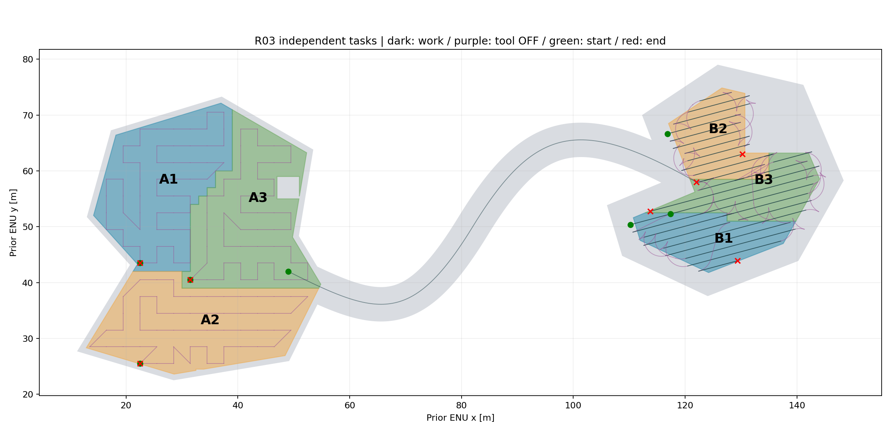
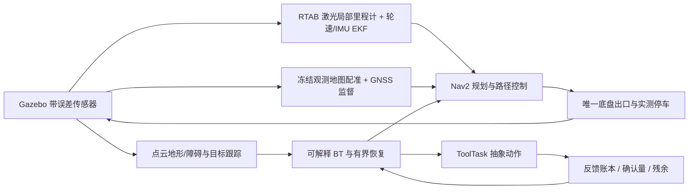
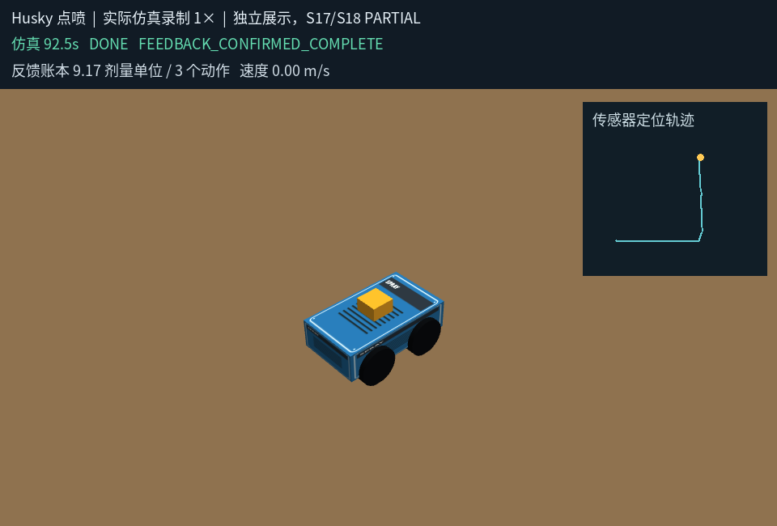
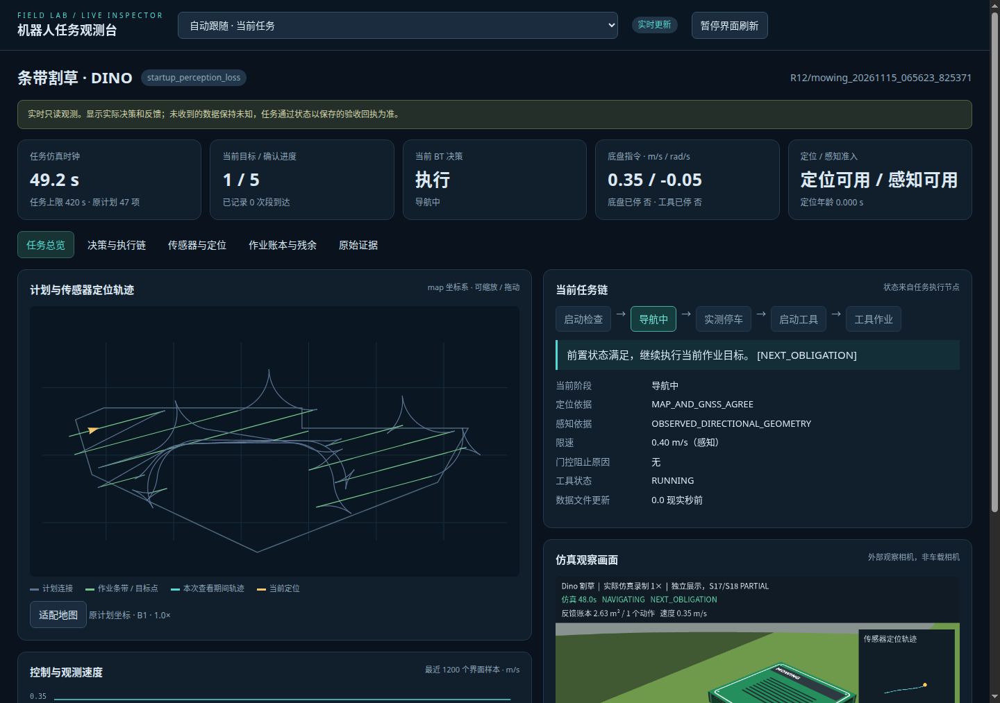

# ROS 2 农田自主作业机器人

同一张连续、不规则的三维农田地图，三个独立运行的机器人任务：**差速点喷、道路巡迹、阿克曼条带割草**。每个工作区由算法按工作量划分三个连通簇，两个工作区用曲线道路连接。项目重点是有观测依据的导航、可解释停车/恢复决策，以及由实际工具反馈确认的作业账本。



## 三个任务

|任务|底盘参考|任务执行|
|---|---|---|
|点喷|Husky A200 尺寸参考的差速车|TSP 点序 → NavigateToPose → 静止定位检查/局部精停 → ToolTask → 计量与残余重试|
|巡迹|Jackal 尺寸参考的差速车|原 88.48 m 连接路 FollowPath；前车跟随、停车恢复、观测绕行、持续受阻上报|
|割草|Dino 前阿克曼底盘|Fields2Cover 原条带、已知坡面裁剪与 OMPL Reeds–Shepp/RRTConnect 安全连接；关刀换向、整车轮廓检查、反馈面积与残余|

车辆是与几何契约一致的轻量仿真模型，不宣称等同商品整机。Dino 后轴最小转弯半径约 3 m，整车外侧转圈直径约 9.82 m；路径同时检查整车轮廓。抽象喷洒/割草执行器提供动作、故障与反馈接口，机械臂及 VLA 留给独立项目。

## 技术结构



- **环境：** Ubuntu 24.04、ROS 2 Jazzy、Gazebo Harmonic；C++ 与 Python。
- **传感器：** 三维激光、双目、IMU、轮速、GNSS、近地扫描；显式噪声、延迟、丢点、外参与时钟新鲜度。真值只进入隔离评估域。
- **定位：** RTAB-Map 原生激光局部里程计，`robot_localization` EKF，冻结的观测点云区域配准与独立 GNSS 创新监督。原生 RTAB 跨车辆高度的全局视觉重定位尚未通过，不把区域点云配准称为该功能已验收。
- **感知与通行：** PCL 点云、地面统计、坡度可观测性、低矮障碍、动态目标与整车扫掠；未知区域保守处理。
- **本轮恢复修复：** 点喷停车候选用独立原始 GNSS 固定解验证，保留原跳变与创新门限；割草在各扫描采集时刻先剔除车体回波，再做运动补偿，遮罩尺寸保持原值。
- **离线规划：** 工作量加权 METIS 连通分簇、OR-Tools TSP/2-opt、Fields2Cover 与 OMPL；规划包络独立计入 Nav2 车身膨胀、栅格半对角线和位姿设计余量，保留原始任务分母。
- **导航：** Nav2 Smac/精确末端规划、RPP 跟踪；保留 MPPI/DWB 配置。点喷最后几厘米通过受约束的 odom 路径修正；割草恢复候选按挡位分段，每段分别控制和确认停车。
- **决策和反馈：** BehaviorTree.CPP 记录原因码、观测证据、等待和重规划次数；工具动作支持取消、幂等重放、故障补作；计量/面积仅由新鲜反馈确认。

## 当前验收范围

|阶段|实际回执|说明|
|---|---|---|
|R08|PASS|[结果](docs/three_tasks/R08/RESULTS.md) · [命令](docs/three_tasks/R08/MANUAL.md)|
|R09|PASS|[结果](docs/three_tasks/R09/RESULTS.md) · [命令](docs/three_tasks/R09/MANUAL.md)|
|R10|PARTIAL|[结果](docs/three_tasks/R10/RESULTS.md) · [命令](docs/three_tasks/R10/MANUAL.md)|
|R11|PARTIAL|[结果](docs/three_tasks/R11/RESULTS.md) · [命令](docs/three_tasks/R11/MANUAL.md)|
|R12|PARTIAL|[结果](docs/three_tasks/R12/RESULTS.md) · [命令](docs/three_tasks/R12/MANUAL.md)|

R10 的完整 A1、新安全执行版 B1 与小规模录像分别评分。原 B1 的 34 段参考路径仍为 PARTIAL：第 20、25、32 段端点与超出 5° 门限的 10° 坡面冲突，经用户明确批准，以新增静态坡面禁行先验生成安全执行版本。原地图、195.99 m² 簇面积、188.39 m² 作业目标并集与历史结果保留；新版本到达不代表原 34 个端点已全部到达；无法保留足够长执行片段的原条带明确记录为遗漏，其面积仍计入残余分母。R11 只改变材质与视觉附件，保持碰撞、传感器和动力学契约；R12 检查真实渲染帧的新鲜度、完整时间线和输出视频。

**原 S17/S18 保持 PARTIAL。** 不包含六十次正式矩阵、未复验 A2/A3/B2/B3，也不宣称真实机械割草有效率或全场 95% 覆盖通过。路径到达、反馈作业面积和残余分别记录。

|案例|结论|完成情况|仿真秒|
|---|---|---|---:|
|spray_full_A1|PARTIAL/FAIL|28/56 点|1402.73|
|spray_tool_jam|PASS|3/56 点|92.79|
|mowing_full_B1|PARTIAL/FAIL|19/47 执行段（原参考 34 段）|879.27|
|mowing_startup_perception_loss|PASS|5/47 执行段（原参考 34 段）|246.91|
|inspection_full_connector|PASS|COMPLETED|343.64|
|inspection_follow_stop_resume|PASS|COMPLETED|108.53|
|inspection_detour|PASS|COMPLETED|100.07|
|inspection_persistent_block|PASS|HUMAN_REQUIRED|79.3|
|mowing_persistent_block|PASS|0/34 执行段（原参考 34 段）|62.73|

## 演示

[精简三任务录像](media/r12_three_tasks_short.mp4) · [停车、跟随、恢复等行为片段](media/r12_behavior_highlights.mp4)。倍速在画面中明确标注，完整原片保存在本机结果目录。




## 实时监视 GUI

```bash
bash optimization_v2/three_tasks/gui.sh
```

浏览器打开 `http://127.0.0.1:8088`，自动跟随当前任务。可查看计划与定位轨迹、BT 决策原因、导航取消/停车/恢复事件、传感器消息频率、车载相机、雷达抽样、控制门控和工具账本；也可选择历史运行。只读界面不会发送运动或工具指令，数据缺失与过期明确显示。



[启动、手工检查与核心代码](optimization_v2/three_tasks/monitor/README.md) · [GUI 检查结果](docs/three_tasks/R12/GUI_RESULTS.md)。GUI 属于独立观测工具，其正常运行不替代任务验收。

## 本机启动与检查

```bash
cd /home/ceihao/robot_project
source optimization_v2/env.sh
bash optimization_v2/three_tasks/advance.sh R10 check
bash optimization_v2/three_tasks/advance.sh R11 check
bash optimization_v2/three_tasks/advance.sh R12 check
bash optimization_v2/three_tasks/advance.sh R12 open
```

较短演示：`bash optimization_v2/three_tasks/advance.sh R12 record spray`。完整复验：`R10 test record_spray_full_A1`、`R10 test record_mowing_full_B1`。详细命令见各阶段 MANUAL.md。同一时刻只运行一个 Gazebo；录制过程中不要 build 或修改绑定源码/配置。

此仓库同步源码、配置、技术说明、精简证据和展示媒体；冻结地图数据库、完整运行环境、大型依赖和原始录像保留在本机，裸 clone 并非可独立启动的发布包。可复现实验须先准备匹配版本的本地资源，不应跳过哈希准入。[本机复现与资源范围](docs/three_tasks/R12/LOCAL_REPRODUCTION.md)。

## 代码与学习材料

- `optimization_v2/ws/src/task_platform/scripts/`：任务编排、规划、恢复、评估及录像。
- `optimization_v2/ws/src/task_platform/r10_backend/`：原始定位监督、停机重验证、全局修正滤波和工具桥生命周期。
- `optimization_v2/three_tasks/editions/`：不可混用的阶段/车辆任务配置。
- `docs/three_tasks/R10/`、`R11/`、`R12/`：手工检查、原理、核心代码及实际结果。
- [本轮修复原理](docs/three_tasks/R10末端定位与分段换向修复_20261115.md)：全局接近/局部精停、换向停车、工具取消和账本心跳。
- [GUI 与本轮有界修复](docs/three_tasks/R10/GUI_AND_BOUNDED_REPAIR.md)
- [安全路径版本](docs/three_tasks/R10/SAFE_EXECUTION.md) · [采集滤波与独立定位恢复](docs/three_tasks/R10/CAPTURE_AND_RECOVERY.md)。

旧版本通过的录像和回执保留；它们只证明原绑定版本，不自动继承到修改后的实现。
