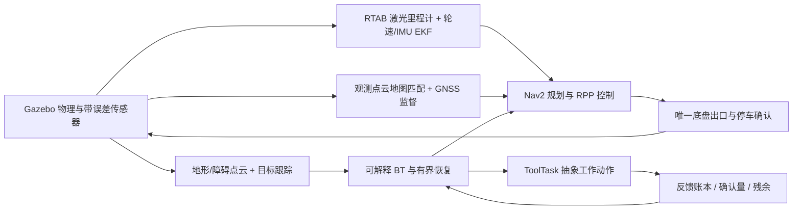
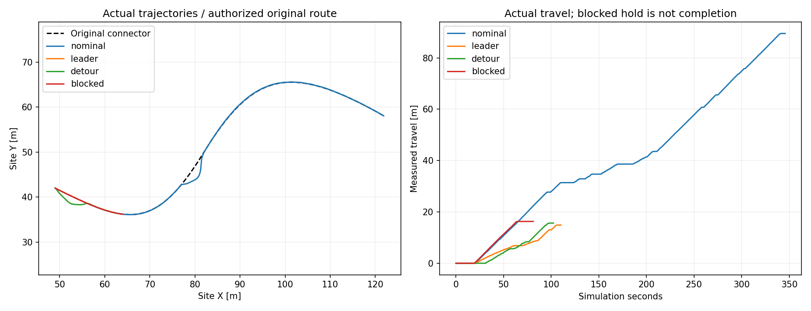

# ROS 2 农田自主作业机器人

同一张三维农田地图，三个分别运行的作业任务：**差速点喷、道路巡迹、阿克曼条带割草**。两个连续不规则工作区通过曲线道路连接，每个工作区通过工作量加权算法划分三个连通簇。车辆先使用与几何契约一致的轻量物理模型，视觉精细化和三任务录像单列后续阶段。

项目把带误差的模拟传感器、定位与障碍感知、规划、可解释行为树、车辆控制和工具反馈连成可检查的闭环。目标是可落地、能解释失败和保留残余任务，不能用路径走完代替作业完成。喷洒与割草执行器是带反馈的抽象动作；机械臂、近景视觉与 VLA 可作为独立项目接入。


## 三个独立任务

|任务|车辆几何参考|主要导航与作业方式|
|---|---|---|
|点喷|Husky A200 尺寸参考的差速底盘|TSP 点序，导航到点、精停、抽象喷洒动作、计量反馈和残余重试|
|巡迹|Jackal 尺寸参考的差速底盘|FollowPath 跟踪原 88.48 m 连接路；前车跟随、停车恢复、观测绕行、受阻上报|
|割草|项目 Dino 前阿克曼底盘|Fields2Cover 条带，满足整车轮廓的 Reeds–Shepp/Dubins 地头连接；关闭工具后换向或转场|

这些是几何参考和实际仿真动力学，不宣称与对应商品整机等价。Dino 后轴最小转弯半径约 3 m，整车外侧转圈直径约 9.82 m；规划同时检查车体轮廓，不能只检查中心线。割草有效幅宽 1.6 m。

## 技术结构



- **环境与传感器：** Ubuntu 24.04、ROS 2 Jazzy、Gazebo Harmonic；三维激光、双目、IMU、轮速、GNSS 和实际近地扫描通道。R08/R09 使用独立版本的 128×2048 主雷达采样及会话专用 DDS 大点云缓冲；旧 R05 配置不变。时间延迟、噪声、偏差、丢点及安装外参均显式配置。
- **定位：** RTAB-Map 原生局部激光里程计与 `robot_localization` EKF；全局定位使用冻结的观测点云区域配准和独立 GNSS 创新监督。原生 RTAB 跨车辆高度的全局视觉匹配未通过，不能把当前结果称为该功能已验收。真值只进入隔离评估域。
- **通行代价：** PCL 点云、地面统计、坡度可观测性、低矮障碍和整车轮廓约束。未知区域保守处理，候选全局路径不等于已观测可通行路径。
- **离线规划：** 工作量加权 METIS 连通分簇；OR-Tools TSP / 2-opt 点服务顺序；Fields2Cover 与 OMPL 生成条带和满足转弯半径的地头段。
- **在线导航：** Nav2 Smac 规划器、RPP 跟踪；阿克曼方向、速度和曲率由唯一控制出口约束。任务行为树使用实际 BehaviorTree.CPP，记录决策原因、输入证据、门限和未选择的候选动作。
- **动态交互：** 当前点云跟踪提供同向跟随、短时横穿保护与观测活动区绕行。使用 CV 未来协方差及有限时长的活动位置记忆，不宣称学会行人意图。历史 S15 学习型预测候选未达收益门槛，继续禁用。
- **有效作业：** 实际模拟工具电机/流量反馈驱动事务账本；面积按保守工具足迹求交、并集，重复经过不重复计数。原始任务分母与残余同时保存。

## 当前可验证范围

|阶段|状态|证据与学习材料|
|---|---|---|
|R07|PASS|[结果](docs/three_tasks/R07/RESULTS.md) · [命令](docs/three_tasks/R07/MANUAL.md) · [原理](docs/three_tasks/R07/TECHNICAL.md) · [代码](docs/three_tasks/R07/CODE.md)|
|R08|PASS|[结果](docs/three_tasks/R08/RESULTS.md) · [命令](docs/three_tasks/R08/MANUAL.md) · [原理](docs/three_tasks/R08/TECHNICAL.md) · [代码](docs/three_tasks/R08/CODE.md)|
|R09|IN_PROGRESS（未封存）|[结果](docs/three_tasks/R09/RESULTS.md) · [命令](docs/three_tasks/R09/MANUAL.md) · [原理](docs/three_tasks/R09/TECHNICAL.md) · [代码](docs/three_tasks/R09/CODE.md)|
|R10|NOT_RUN|[结果](docs/three_tasks/R10/RESULTS.md) · [命令](docs/three_tasks/R10/MANUAL.md) · [原理](docs/three_tasks/R10/TECHNICAL.md) · [代码](docs/three_tasks/R10/CODE.md)|



R01–R06 已分别完成启动退出、几何、离线路径、动力学、短程定位和 BT 协议验收。R07 PASS 限定原 A1 前三个点及工具故障恢复；R08 必须包含完整连接路及三个交互案例；R09 组件案例限定原 B1 前五段；R10 另外检查完整 A1、连接路和 B1 路线及声明的故障案例。具体完成量以对应结果文件为准，已准备代码不等于已通过。

**原 S17/S18 继续保持 PARTIAL。** 不执行六十次正式矩阵，不把未运行的 A2/A3/B2/B3 推定为通过。条带段抵达与工具有效面积是两个指标；原 95% 标准保留，未确认面积不会清零。原 B 区可用 1120 m²，本版内侧任务 586.40 m²，其余 533.60 m² 保留为未计入的地头及边缘义务。

## 本机使用

```bash
cd /home/ceihao/robot_project
bash optimization_v2/three_tasks/advance.sh status
bash optimization_v2/three_tasks/advance.sh R08 check
bash optimization_v2/three_tasks/advance.sh R08 open
bash optimization_v2/three_tasks/advance.sh R09 open
bash optimization_v2/three_tasks/advance.sh R10 open
```

实际复验命令、选择范围和停止条件见各阶段手工说明。每次运行一辆车，等有序退出后再启动下一个任务。原地图、正式任务与旧回执保留，新的配置、结果和学习材料使用独立版本。

```text
optimization_v2/three_tasks/       独立任务入口、配置版本和本机结果
optimization_v2/ws/src/task_platform/  任务、导航适配、BT 与评估源码
optimization_v2/ws/src/           定位、感知、工具和账本等共享包
docs/three_tasks/                分步任务书、命令、技术与核心代码说明
validation/                     发布的精简实测证据
media/                          图、截图及历史独立演示
```

本仓库同步源码、配置、说明和精简证据。完整冻结数据库、构建产物及逐帧记录仍绑定开发机，**尚不是 R12 的可移植发行包**。已有图片和视频应按其说明理解为对应历史阶段的真实演示，不是新三任务全部完成的录像。模型外观与正式录制分别留给 R11、R12。
