# ROS 2 农田自主作业机器人

在三维仿真场景中，用同一套任务与安全接口运行两种机器人：差速车逐点喷洒，阿克曼车连续割草。两个连续不规则作业区通过曲线道路连接；工作区由算法划分为三个连通簇，再生成点服务或条带路径。

项目重点是把 **传感器 → 定位与感知 → 规划 → 可解释行为树 → 导航控制 → 工具反馈账本** 连成可检验的闭环。在线算法接收带误差的模拟观测；仿真真值仅用于独立评分。喷洒与割草执行器抽象为动作接口，后续可独立接入机械臂、近景视觉或 VLA。

> 开发机阶段验收：S14 PASS、S15 PASS、S16 PASS；S17 PARTIAL（0/60 正式簇运行），S18 PARTIAL（独立部分交付）。S15 的默认策略为 `no_prediction`；未达收益门槛的预测候选保持禁用。新机器需安装、构建与重新验收。

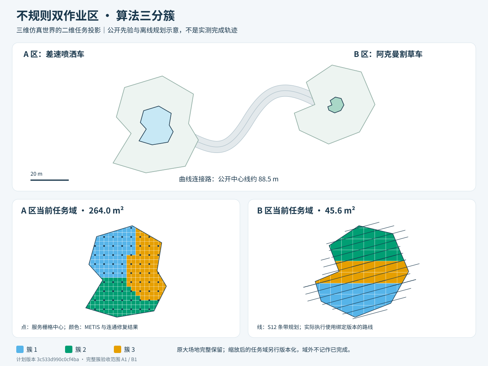

<table>
<tr><th>差速点服务底盘</th><th>阿克曼连续覆盖底盘</th></tr>
<tr><td></td><td>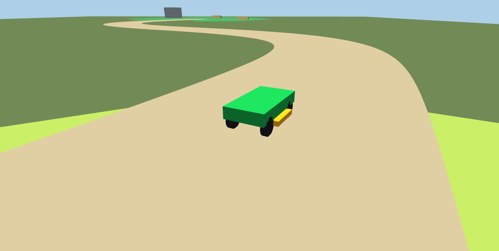</td></tr>
</table>

底盘图来自 S03 的真实 Gazebo 验收截图；后续阶段增加传感器、定位和导航接口。上方总览图展示公开先验和算法分簇，不计作实际完成量。


## 独立小规模演示与实际录制

本轮优先完成可录制的功能演示，暂缓六十次正式矩阵与全部消融。保留原地图、正式任务及验收标准；以下是独立缩小的三簇点服务和三簇条带任务，每行对应一个演示任务；显式恢复的多个运行片段共同记账，不作为可靠性统计。S17 继续为 PARTIAL，S18 PARTIAL（独立部分交付）。

**独立演示状态：PARTIAL（6/8 项义务通过）**。未完成项目和安全退出不计完成。

[精简展示视频（倍速总览 + 实速回看）](media/showcase_short.mp4) · [完整运行章节录像](media/full_demo.mp4) · [启动、手工检查与核心算法说明](docs/optimization_v2/showcase/README.md)

[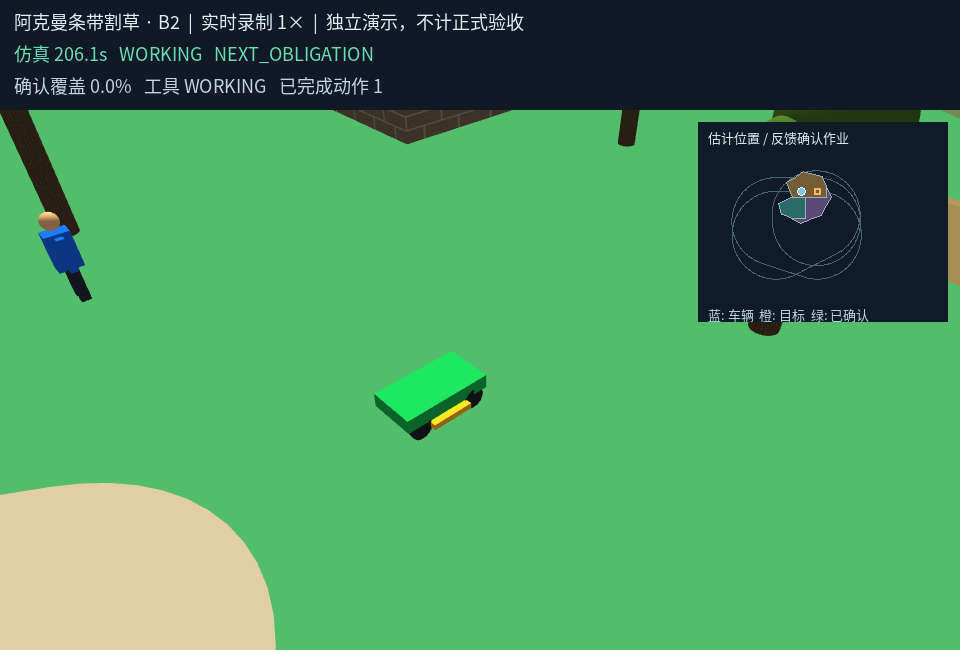](media/showcase_short.mp4)

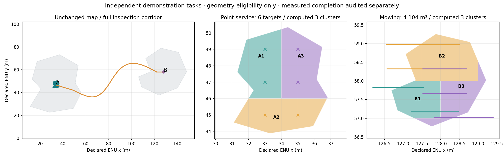

| 任务 | 实际结果 | 反馈确认 | 仿真秒（含收尾） |
|---|---|---|---:|
| A1 | PASS | 2/2 点 | 168.0 |
| A2 | PASS | 2/2 点 | 179.4 |
| A3 | PASS | 2/2 点 | 145.1 |
| B1 | PASS | 98.22% | 586.0 |
| B2 | PASS | 98.72% | 578.6 |
| B3 | PASS | 97.22% | 1248.0 |
| road_diff | FAIL | 未完成 | 1447.9 |
| road_ackermann | PARTIAL | 未完成 | 925.7 |

累计计入本轮录制预算 179.2 分钟，包含未通过尝试；修复探针单独记录。完整视频由独立真实任务章节拼接，底盘分别运行，并非一辆车无重启完成全部任务。精简版标注倍速，保留原始仿真时钟，并加入关键事件实速回看。

新增只读运动监视页：区分当前栅格不连通、车辆路径尚未解决、传感器/定位无效和长时间无进展。持续无进展时，原任务控制者负责停车、关工具、保存残余并上报人工检查；正常原地转向和点服务驻留不会被当作静止故障。安全退出不计作任务完成。

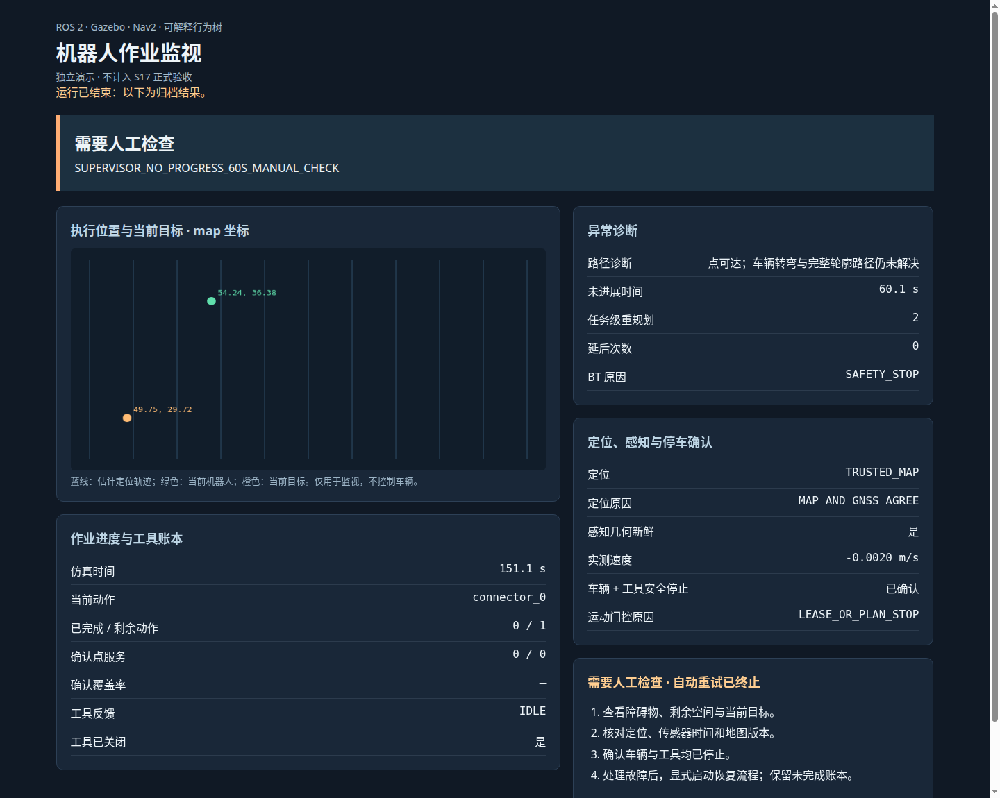

演示采用独立的局部停让演员和动态/静态历史分离适配。原非交互场景及失败证据保留；这些演示结果不替代原 S17 正式验收。动态历史过滤修复后的阿克曼短段完成了真实复验，零碰撞、零越界；详情见 [独立验收回执](validation/showcase/demo_acceptance.json) 和 [开发试运行记录](validation/showcase/development_journal.json)。

仓库同步源码、演示任务、精简证据和两种视频；S17 完整资格点云、父地图大输入与原始运行日志仍保存在开发机，未作为 S18 可移植发布包交付。原 S14/S15 资产包保持可用。

## S18 部分交付与轻量外观（2026-11-14）

按最新要求提前整理可人工验证的交付部分：统一 `spray / mow / inspect / stop / resume` 入口，地图/计划绑定诊断，18 步学习索引，受保护有界存储组件，以及文件级证据审计。**S17 和 S18 仍为 PARTIAL；没有执行六十次正式矩阵，也未认证整张地图全部条件满足。**

[快速开始](docs/optimization_v2/快速开始.md) · [S18 技术原理](docs/optimization_v2/S18/TECHNICAL.md) · [核心代码](docs/optimization_v2/S18/CODE_WALKTHROUGH.md) · [手工检查](docs/optimization_v2/S18/MANUAL_CHECK.md) · [实测结果](docs/optimization_v2/S18/RESULTS.md) · [审计摘要](validation/S18/summary.json)

```bash
# 当前开发机，每次运行一个入口；默认 180 仿真秒 / 540 现实秒
bash /home/ceihao/robot_project/optimization_v2/run.sh doctor
bash /home/ceihao/robot_project/optimization_v2/run.sh spray --cluster A1 --gui
bash /home/ceihao/robot_project/optimization_v2/run.sh mow --cluster B1 --gui
bash /home/ceihao/robot_project/optimization_v2/run.sh inspect --vehicle diff --gui
# 第二个终端停止当前会话
bash /home/ceihao/robot_project/optimization_v2/run.sh stop
```

新增跟随模块已验证“前方同向目标、车体净间距、目标丢失停车、目标转向保护”等离线逻辑。**尚未接入 ROS/BT 闭环，不能称为已完成跟随录像。** 旧矩阵、原覆盖分母及未完成残余保持不变。

<table><tr><th>差速外观预览</th><th>阿克曼外观预览</th></tr><tr><td>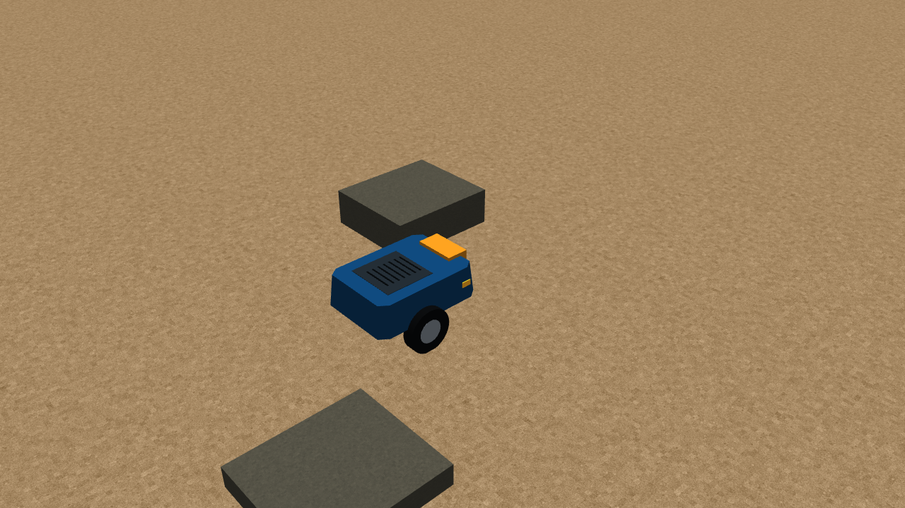</td><td>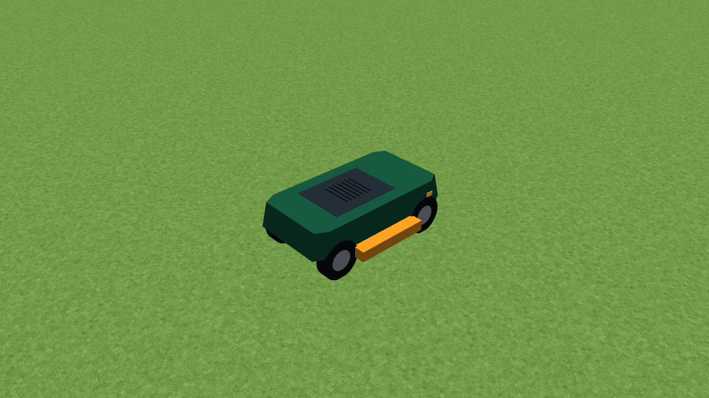</td></tr></table>

以上为真实 Gazebo 静态渲染，包含轻量倒角车壳、轮毂、面板和程序化地表材质。隔离生成的新外观保持原碰撞体/惯量/关节/传感器配置；预览另加只读摄像头。新视觉可能改变相机与 GPU 激光观测，未替换正式默认模型，感知与运动回归待完成。Gazebo 收尾的 -11 返回码也保留为未解决问题。

本轮 20 项组件检查、577 个本地学习链接和 41,212 个原回执绑定文件核验通过；S18-C03 PASS，其余交付子项 PARTIAL。5 次短探针累计约 4.94 分钟仿真时间 / 9.72 分钟现实运行时间，差速点服务、阿克曼部分割草及差速恢复后停车获得有效安全/定位证据，过短预算的失败探针保留。

本次同步新增源码、纹理、真实预览和精简检查证据；开发机完整原始日志与绑定资源未全部发布，不能视为全新机器可直接运行的完整安装包。存储组件测试通过，但旧录制器配额接入仍未完成。

## 割草转弯尺度核查（2026-11-13）

用户观察到的大圈存在任务尺度不匹配：旧录制割草任务总面积仅 4.104 m²，而阿克曼规划半径仍为 2.11 m，合计约 93.1% 的参考里程用于关刀移动。原灰线代表规划路径，不等同已执行轨迹。底盘几何自洽，但该小任务不能代表商用割草效率。

新增比例尺、计划/反馈图例、可复现的半径与空驶核查及 6 项回归检查。37.095 m² 独立离线候选虽通过几何检查，空驶仍约 77.7%，设计门槛拒绝采用，实际运行 NOT_RUN。原默认任务和录像保留；S17 PARTIAL，S18 PARTIAL（独立部分交付）。

[参数、商用对照、原理、检查命令和后续修正](docs/optimization_v2/showcase/割草转弯半径与场地尺度核查.md)


## 下一轮展示范围：逐项行为

优先分别展示路径跟踪、障碍停车与恢复、可行绕行、长期阻塞安全结束和反馈账本；不要求每段录像完成全部任务或达到 95%。仍公布原分母上的覆盖率和残余，正式 S17 标准保持不变。目标跟随尚未验收；演员让行不等于机器人绕障成功。

适合先做轻量材质和视觉网格升级，再用短测检查相机、GPU 雷达、定位及性能。此处是准备度判断，尚未更换模型或启动新录像。[逐项证据、录像标准和视觉方案](docs/optimization_v2/showcase/分项行为录像与视觉升级判断.md)

## 系统结构

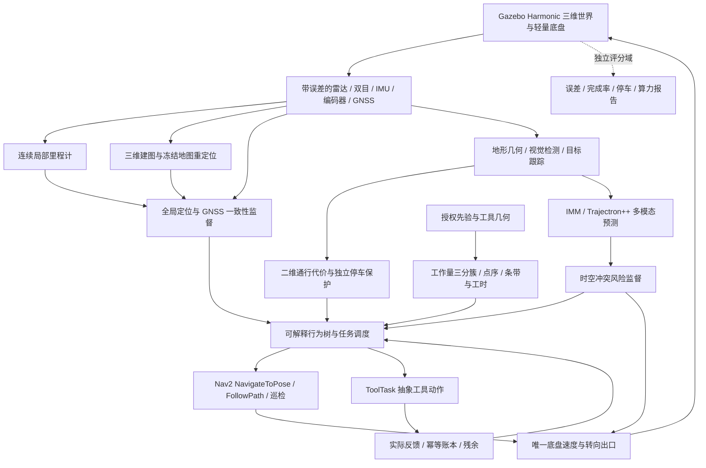

## 算法与技术栈

| 模块 | 当前实现 | 选择理由与边界 |
|---|---|---|
| 仿真 | Ubuntu 24.04、ROS 2 Jazzy、Gazebo Harmonic；差速与阿克曼轻量模型 | 同图分别运行，降低算力需求；无真实机械臂 |
| 传感器 | 32×1024 主三维雷达、128×32 近场补盲雷达、640×360 双目、IMU、编码器、GNSS；误差与失效注入 | 定位与避障使用独立处理分支；瞬时扫描不宣称扫描内去畸变 |
| 局部定位 | 轮速/IMU 与激光里程计、robot_localization | 连续 odom；不把全局修正重复当作独立测量融合 |
| 建图 | RTAB-Map、视觉地点检索、点到面 ICP、GTSAM 位姿图 | 保存真实观测数据库；回环须通过几何质量检查 |
| 全局定位 | 冻结图重定位、区域激光地图、GNSS 坐标与杆臂修正、一致性门控 | 唯一 map→odom；版本失配或参考失效时拒绝任务 |
| 三维感知 | PCL 地面与局部平面、坡度/台阶/可观测性、NanoDet 与三维关联 | 三维观测投影为二维通行代价；未知不自动当空闲 |
| 分簇 | METIS 加权图划分、连通修复、有界边界交换；K-means 对照 | 固定三簇，保留边角和孔洞，不保证全局最优 |
| 点服务 | 可见图/Dijkstra 距离、OR-Tools TSP、NN+2-opt 对照 | 按真实运动与停靠工时选择候选；不直接采用欧氏穿障距离 |
| 割草覆盖 | Fields2Cover 条带、Dubins 转场、车体扫掠与曲率验证 | 阿克曼不能原地旋转；曲率切换处停车并确认转角 |
| 控制 | Nav2 DWB、RPP、MPPI；Smac Hybrid-A* | 当前点服务使用 DWB、条带使用 RPP，MPPI 保留对照；计划路径不等于实际作业完成 |
| 动态预测 | IMM CV/CA/左右转弯；固定 ETH 权重 Trajectron++；CPU 隔离推理 | 在线观测历史与邻居，3.2 秒多模态输出；近 2 秒风险只能收紧速度，默认选择由实测决定 |
| 决策 | BehaviorTree.CPP + Python 任务执行器 | reason_code、证据、候选成本、迟滞、取消握手和有界重试 |
| 作业账本 | ROS 2 Action、SQLite、几何并集与残余导出 | 按新鲜且身份匹配的实际工具反馈记账；取消前的已确认作业保留，失联和重复请求不能虚增完成量 |

完整簇当前使用经实际观测测站配准的区域激光地图；RTAB-Map 建图与冻结图重定位基线保留。近场补盲雷达是额外模拟测距通道，并非从主雷达凭空补出的观测。

C++ 负责关键 ROS 节点、几何与控制接口；Python 负责仿真编排、任务调度、离线规划、账本和报告。具体依赖版本由 `optimization_v2/config/*lock*` 记录。

## 任务与验收方式

- 喷洒：到达目标停车点 → 工具准入 → 驻留 → 反馈确认 → 下一点。
- 割草：进入作业带 → 开工具并等待反馈 → FollowPath → 停工具 → 转场；按有效工具足迹并集计面积。
- 巡检：工具关闭，执行连接路导航与检查点记录。
- 每簇正式任务含停车收尾最多 **1800 仿真秒**，离线名义计划目标 **1440 秒**；这不是整套测试的现实耗时上限。
- 当前导航准入速度上限为 **0.12 m/s**，割草命令保留裕量至 **0.11 m/s**；车辆配置中的更高候选速度尚不能据此声明通过完整作业验收。
- 当前固定完整簇验收分母为 A1 的 **21 个点**、B1 的 **16.3594578796 m²**。原大地图仍保留；当前任务规模由工时闭环显式选定，不表示整张农田已完成覆盖。
- 短测标记 `SMOKE`；未完成、超时和安全拒绝保留 `PARTIAL` 与原始残余。

## 已完成的真实验收

S14 的冻结地图、GNSS 区域配准、规划版本和完整簇已复验。以下为固定任务分母的结果，包含返回与停车收尾：

| 完整簇 | 实际结果 | 仿真用时 | 独立定位误差 P95 |
|---|---|---|---|
| A1 差速点服务 | 21/21 点，返回完成 | 1283.063 s（21.38 分钟） | 0.0114 m |
| B1 阿克曼割草 | 5 条作业带与全部 11 个子任务完成；16.2763 / 16.3595 m²，覆盖率 99.4915% | 1531.663 s（25.53 分钟） | 0.00636 m |

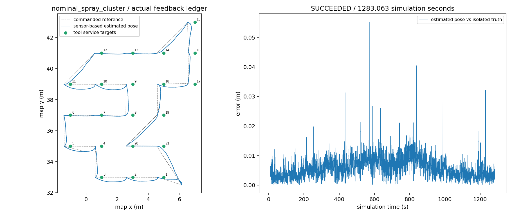


故障验收包括定位参考失效、低障碍、预算耗尽、持续封堵与工具失联。预期拒绝、保存残余和安全停车也是故障实验结果；不计作任务完成。`decision_story` 的故障演示在完成 1/2 点后因重试预算耗尽结束，未将它改写为全部成功。

恢复资产后，打开 [S14 交互回放](validation/s14/index.html) 可查看实际 BT 理由、轨迹、反馈账本和残余。GitHub 文件页不运行 HTML，请在本地浏览器打开。Gazebo 在确认停车、工具关闭和暂停后的清理阶段仍可能返回 −11；清理退出码与任务结果分别记录。

## 动态预测的真实对照与演示

S15 完成了 IMM（匀速、加速、左右转弯）和官方固定权重 Trajectron++ 的实际推理适配。输入只有在线观测历史和邻居，输出未来 3.2 秒的多模态轨迹；未来标签仅用于离线评分。

数据集按整段 episode 划分：训练诊断、验证、测试各 4 段，分别包含转弯、停走、脚本让行和遮挡。网络未重新训练；这些相近场景变体不能作为开放世界泛化证明。

| 测试方法 | 加权 ADE / FDE（米） | 95% 矩椭圆覆盖率 | 离线推理 P95（毫秒） |
|---|---|---|---|
| 因果 CV 评分参考 | 0.083 / 0.157 | 100.0% | 0.14 |
| IMM | 0.132 / 0.268 | 100.0% | 1.65 |
| Trajectron++ | 0.563 / 1.117 | 69.9% | 6.81 |

每种方法在同一批 **128 个测试窗口**上评分。CV 只用于离线误差参考；闭环的 `no_prediction` 不向控制器发送未来预测。表中推理延迟不等于完整 ROS 链路延迟，后者见交互报告。

| 闭环方法 | 实际完成 | 障碍物碰撞 | 平均任务时间（仿真秒，含停车） |
|---|---|---|---|
| `no_prediction` | 4/4 | 0 个案例 | 53.73 |
| `imm` | 3/4 | 0 个案例 | 64.92 |
| `learned` | 4/4 | 0 个案例 | 63.39 |

正式矩阵包含 **12 个正常闭环对照 + 3 个故障实验**，固定相同的场景与两点任务。未完成任务的耗时仍包含在均值中，不能把它看作成功任务效率。超时、真实进程失联和大协方差故障均验证回退到当前观测安全基线。

**本轮默认策略：`no_prediction`。** 这是预注册门槛根据真实结果作出的选择；阶段实现验收通过，不等于预测模型有性能提升。候选状态如下：

- `imm`：disabled；原因：`NEW_FAILED_TASK, INCOMPLETE_PAIRED_SUCCESS_EVIDENCE, INSUFFICIENT_MEASURED_CONFLICT_EXPOSURE`。
- `learned`：disabled；原因：`NO_EFFICIENCY_QUALIFICATION, CALIBRATION_NOT_QUALIFIED, INSUFFICIENT_MEASURED_CONFLICT_EXPOSURE, NO_LEARNED_ACCURACY_GAIN`。

风险量是模式包络相交的代理，不是已校准的碰撞概率。实测冲突分母不足时记 N/A，不能声明零漏报。两点差速基准不替代完整六簇，也不替代阿克曼动态条带中断验收。

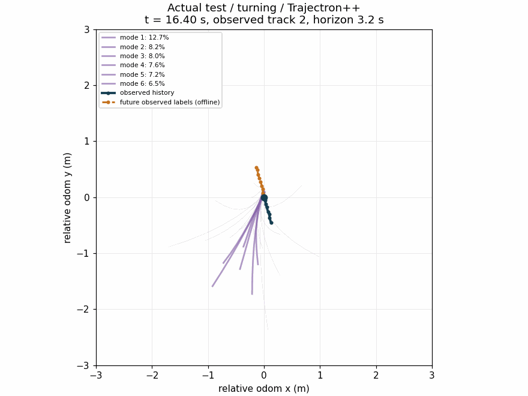

动画来自冻结测试观测和真实模型输出，是离线窗口回放；深色为历史，紫色为未来分支，橙色为仅在评分时使用的未来观测。坐标以当前观测为原点，显示范围 ±3 米。模型预测不准的情况原样保留。

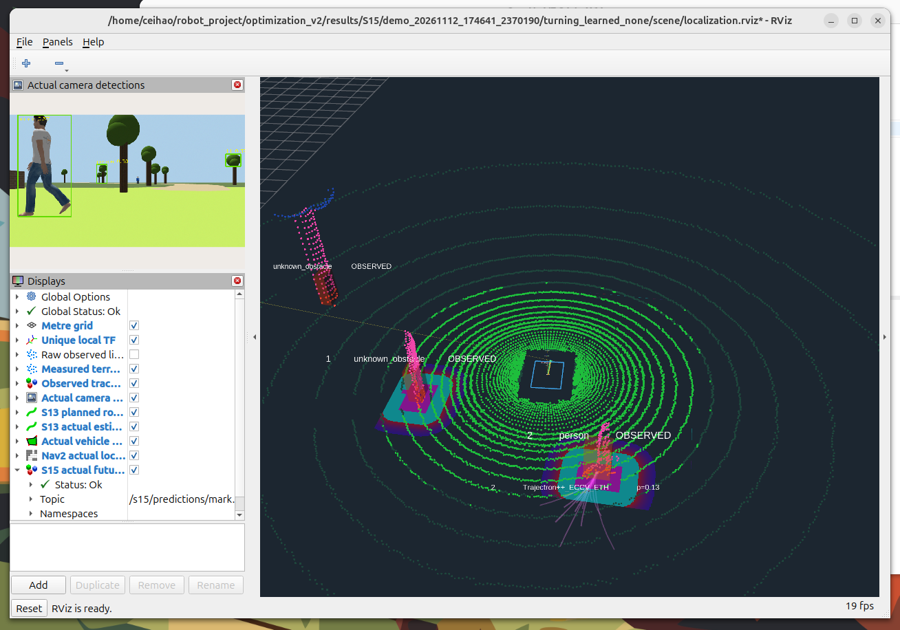

实际 RViz 演示显示点云、跟踪目标、未来分支和概率。显示参考系的单独修正及复验证明见 [UI_VALIDATION](docs/optimization_v2/S15/UI_VALIDATION.md)；原 15 项矩阵保留原始版本记录。


相机图来自实际 S15 采集；刚体行人网格没有关节步态动画，右侧树木存在误检，未为展示目的删除。当前感知与预训练模型均仍有域差异。

恢复资产后打开 [S15 交互报告](validation/s15/index.html)，可切换场景、模型和观测时间，检查概率、风险、BT 理由、任务完成和算力。模型来源及许可见 [模型锁](optimization_v2/config/model_lock.yaml)；媒体来源与哈希见 [MANIFEST](media/MANIFEST.json)。

## 项目目录

```text
optimization_v2/
  ws/src/          ROS 2 包、算法与真实测试
  config/          传感器、车辆、定位、规划、行为与依赖锁
  datasets/        按整段场景拆分的预测观测数据集
  maps/            授权先验、冻结地图与区域地图
  plans/           三分簇、离线路径及版本绑定
  behavior_trees/  任务行为树
  contracts/       数据、动作与理由码合同
  stages/          每步运行入口
  lessons/         C++ / Python 教学示例
  stepctl.sh       list / status / demo / test / check / open / stop
 docs/optimization_v2/
  prompts/         S01–S18 分步执行要求
  SNN/             原理、核心代码、手工验收和实际结果
```

## 运行入口

先阅读 [构建与资产恢复](BUILDING.md)。以下接口已经在开发机使用；新机器需安装依赖、恢复资产、构建并重新验收，不能复制开发机 PASS 回执。独立场景预览入口可在没有开发机回执时查看实际世界和静止底盘。

```bash
bash optimization_v2/stepctl.sh list
bash optimization_v2/stepctl.sh status
bash optimization_v2/stepctl.sh check S14
bash optimization_v2/stepctl.sh open S14
```

`test` 执行真实测试；`check` 只校验现有回执、源文件和输入哈希；`demo` 不自动替代正式验收。仿真实验串行运行，`stop` 仅结束本步骤拥有的进程。

## 学习与扩展

已实施阶段提供 `TECHNICAL.md`、`CODE_WALKTHROUGH.md`、`MANUAL_CHECK.md`、`RESULTS.md`，以及可实际编译/运行的 C++ 和 Python 示例。阶段执行要求见 [18 步命令合集](docs/optimization_v2/命令Prompt合集.md)。

学习入口：[S14 技术原理](docs/optimization_v2/S14/TECHNICAL.md)、[S14 核心代码](docs/optimization_v2/S14/CODE_WALKTHROUGH.md)、[S15 技术原理](docs/optimization_v2/S15/TECHNICAL.md)、[S15 核心代码](docs/optimization_v2/S15/CODE_WALKTHROUGH.md)、[S15 手工查验](docs/optimization_v2/S15/MANUAL_CHECK.md)。

动态多模态预测由 S15 管理；S16 经验检索与算力对照已实施，S17 六簇综合验收正在修复，S18 完整移植交付未执行。项目面向仿真研究和工程学习，未作实车商业认证。
