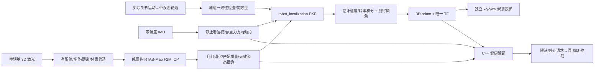

# S05 技术说明：连续局部里程计与观测健康

本步是局部里程计，输出 `/s05/odometry` 和唯一 `odom→base_link`（由 s05_local_odometry 统一发布）。默认由 ROS 2 Jazzy 的 robot_localization 3.8.3 EKF 融合观测，纯激光前端为 RTAB-Map 0.23.13 `icp_odometry`。没有提前实现 S06 回环建图、S07 地图重定位或 S08 GNSS 全局校正。实际是否通过以 `stepctl check S05` 与本轮 RESULTS 为准。

## 数据流与为什么这样选

Gazebo 实际渲染/物理传感器在 domain 121 生成带误差数据；估计和控制在 domain 119；机体真值在 domain 120 独立记录，运行结束才供评分器读取。ROS domain 是工程隔离边界，不是安全访问控制。静态 TF 来自已验证外参，车体绝对出生坐标不传给在线算法。相机、GNSS 继续由 S04 生成，但没有在本步融入 EKF。

| 输入 | 实际融合量 | 不重复使用的量 | 选择原因 |
|---|---|---|---|
| 轮速 Twist | 车体 vx；vy=0、vz=0 带协方差滚动约束 | 轮速积分 pose、轮速 yaw_rate | 避免同源位姿/速度双重加权；角速度优先用陀螺仪 |
| IMU | 加速度方向估计 roll/pitch；校准后 wx/wy/wz | 绝对 yaw；线加速度 | 无绝对航向参考；避免未充分建模加速度直接积分漂移 |
| ICP Odometry | 独立激光 pose 的短窗口速度增量 | 原始绝对 pose、上游原始 Twist；任何轮速/IMU/滤波位姿初值 | 保持增量源独立，不把融合结果再次当新观测回灌 |

低速非侧滑模型中 vy/vz 的零约束在**车体坐标**成立；不会把世界系坡道的竖直速度强制清零。严重侧滑时该假设不再可靠，不能宣称所有轮胎地面条件都覆盖。

## 估计数学与三维姿态

robot_localization 是 15 状态普通 EKF：`[x,y,z,roll,pitch,yaw,vx,vy,vz,wx,wy,wz,ax,ay,az]`。**不是带 IMU 偏置状态的 ESKF**。误差状态滤波是可参考的设计思想，但本步没有把上游实现更名为 ESKF。

本机 3.8.3 的 ROS reset 会用成员矩阵恢复 Q/P；缺省未显式加载时，复位实测出现线速度协方差为零、里程计不跟随运动。现配置显式写入上游原本启动默认 Q 对角值和 P=1e-9 I，并验证 reset 后速度/轨迹误差及三估计器实际 reset 应答。首次启动的有效 Q/P 与原默认相同，不通过更改正常噪声水平掩盖复位问题。

预测：`x⁻=f(x,dt)`，`P⁻=F P Fᵀ+Q`。更新：创新 `r=z−h(x⁻)`，`S=H P⁻ Hᵀ+R`，`K=P⁻HᵀS⁻¹`，`x⁺=x⁻+Kr`。上游实现包含角度归一化、Mahalanobis 门控以及 Joseph 形式协方差更新。实际版本源码与 BSD 许可保存在 references/S05。

启动前 1–4 仿真秒静止采样估计陀螺零偏。这是一次启动校准，不是在线偏置状态估计。加速度方向单独估计 `roll=atan2(ay,az)`、`pitch=atan2(-ax,sqrt(ay²+az²))`，时间常数 0.25 s；不再将同一陀螺积分出的姿态与陀螺速率重复作为独立观测。仅当 `|‖a‖−g|<0.25 m/s²` 且轮速加速度小于 0.2 m/s² 时更新倾角，否则设置 orientation covariance[0]=-1 表示该姿态观测无效，角速度仍可用。持续转弯的向心加速度仍可污染重力方向，这是该轻量方法的边界。

保持 `two_d_mode:false`。ENU 世界 z 向上，base_link x 向前、y 向左、z 向上；单位 m、s、rad。计算 `a_free=a−Rᵀ[0,0,9.80665]` 发布 `/s05/imu/gravity_removed` 供检查，**该加速度并未融入 EKF**。规划位姿另投影成 x/y/yaw，z=roll=pitch=0，只发布 PoseStamped，不发布第二条 TF。坡道检查必须看到真值/估计 pitch 随实际 5° 坡道变化，不能用平面轨迹图代替验证。

## 连续 odom 的输出方式

原 EKF 状态通过位置—速度交叉协方差，能在只更新速度时仍修正位置；在阿克曼及差速实测中出现 0.21–0.26 m 瞬时位置变化。短窗口增量降低了抖动但未完全消除。因此主 EKF 发布 `/s05/raw/fused`，对照 EKF 发布 `/s05/raw/wheel_imu`；这里 raw 是估计器原始输出，不是 Gazebo 理想观测。

`s05_local_odometry` 对两种 EKF **同样**积分估计车体速度，`pₖ₊₁=pₖ+R(roll,pitch,yaw中点)·v̂·dt`，航向由估计转率按三维 Euler 关系积分，roll/pitch 保留 EKF 测得的倾角。绝对 pose 不用于纠偏，不裁剪位置跳变，不用真值修正。原 EKF pose 在观测日志保留，因而能审计该工程取舍。轮速基线也本来就是速度积分，比较使用相同位移累计概念。

这样输出连续、不会突然改变局部原点，但**不会修复速度估计本身的偏差**；偏差仍会积成漂移。输出协方差以旋转后的速度协方差积分加模型噪声近似传播，忽略跨时刻相关性，不能视为经校准的置信区间保证。断流超过 0.5 s 不跨未知时段积分；新 epoch 清零并重新初始化。该输出结构不改变上游 EKF 为普通 15 状态 EKF 的事实，也不宣称为完整紧耦合惯导。

## ICP 配准、可观测性与参数取舍

雷达保留 S04 的 32×1024、10 Hz；定位前端主动取 5 Hz，最多 2500 点，0.20 m 体素，距离 1–40 m，去除车体邻域。感知支路与原始 S04 传感器频率不变。当前参数 `ground_stride=1` 保留筛选后的地面点；尝试强抽稀地面会破坏稀疏扫描配准，已被实测否定。

使用 RTAB-Map Frame-to-Map 局部扫描地图，libpointmatcher 点到平面 ICP：最小化 `Σ ρ(nᵢᵀ(Rpᵢ+t−qᵢ))²`。对应距离 0.5 m，25 次迭代，局部地图上限 12000 点。只能使用 ICP **自身**过去的运动估计，平滑窗口 1.0 s；`guess_frame_id` 为空，`wait_imu_to_init:false`，订阅图再检查无 wheel/IMU/filtered odometry 输入。

单纯高匹配比例不足以说明可定位。前端按邻域法向构造未中心化二阶矩 `M=Σnnᵀ/N`，最小特征值小表示某方向缺乏约束。要求自己的 `λmin≥0.005` 且 ≥150 点，RTAB-Map 自身复杂度门限 0.02，低复杂度策略 0=拒绝，匹配比例≥0.15。ICP lost 的零四元数和 9999 协方差必须在进入 scipy/滤波器前拒绝。

轮速与通过质量检查的激光位移速度（约 0.8 s 窗）比较，按激光观测时刻对齐同一 0.8 s 窗口的轮速均值，差值超过 0.08 m/s 持续 0.3 s 后将轮速 vx 方差从 0.0025 提高到 4.0 `(m/s)²`，减小可疑轮速权重；恢复要求差值低于 0.04 m/s 连续 1.5 s，避免权重反复切换；它是启发式可靠性调度，并不是能完美区分轮滑和激光漂移的故障分类器。ICP 原始 pose 留作诊断；用最近约 0.8 s、至少 0.5 s 的合格位姿差分求车体系速度。协方差以 `(Σ前+Σ后)/Δt²` 传播，线速度方差下限 0.0025、角速度方差下限 0.0004；只把 `/s05/inputs/icp_increment` Twist 交给 EKF，Mahalanobis 参数 4.0。超过 1.2 m/s 或 0.8 rad/s 的不合理增量拒绝；断流后清空窗口，不跨大缺口差分。不能把 ICP 相邻相关增量理解为严格独立的统计样本。

## 健康状态、所有权、重置

唯一公开动态 TF 发布者为 s05_local_odometry。主 EKF 和对照 EKF 均关闭 TF 并私有化其端点。关闭 RTAB-Map、对照 EKF 的 TF，并将其仍会创建的 TF 端点分别 remap 到私有主题；原 S03 底盘 TF 也私有化。原 S03 驱动/看门狗/停车阈值未修改，唯一实际执行出口仍是 s03_drive_bridge。

- 启动/新 epoch 8 s 禁止运动。
- IMU 观测年龄 >0.25 s，或融合 odom >0.25 s：STOP。
- ICP 无效或年龄 >0.6 s：DEGRADED，最高 0.2 m/s；持续 2 s：STOP。
- 正常 S05 资格路线最高 0.45 m/s。前向距离保护继续使用 S03 停车净空模型；无障碍规划能力不在本步范围。
- `/clock` 倒退或 `/s05/reset_epoch`：清理观测状态、新 epoch、调用三个估计器 reset；新 epoch 的轨迹不能与旧原点拼成一条连续轨迹。
- 现有底盘 wall watchdog 在仿真暂停时仍停车。正式测试的物理停止要求维持 `v<0.01 m/s`、`|w|<0.02 rad/s`、响应 <2 s。

ICP 健康状态要求增量已实际发布；只有有效 pose 而无合格增量不足以恢复。数据恢复可能再次满足健康条件，但“数据当前可用”不证明累计轨迹误差已消失。无全局校正的里程计会保留漂移；故障后继续任务的策略应在后续全局定位/任务层进一步限定。

## 实验、可解释指标与失败边界

正式矩阵依次运行差速/阿克曼正常闭环、故障序列、5° 坡道，以及差速实际 Gazebo 时钟重置、两车独立 IMU 行驶中失联。正常闭环选择原有泵房附近可见结构的区域（不添加人工定位标记）；缺特征区域的全场可用性未在本步证明。坡道测试差速从西侧平地起步，阿克曼从 x=40 m 的坡面起步，由私有仿真器放置相应高度和倾角；在线算法仍只看传感器。两者均需跨实际坡面行驶 >7 m 并保留俯仰。阿克曼原平地入口初始 ICP 地图复杂度不足，诊断停车，不能靠降低退化门限通过。每个案例有真实 runtime 命令、退出码、观测与独立真值。故障表固定 seed 41：20–50 s 轮速 +30%；52–61 s 陀螺 z +0.04 rad/s；65–79 s 激光只剩地面；86–94 s IMU 丢失。另有独立 IMU 用例：20–28 s 丢失，要求掉线前实际车辆仍在运动，避免把已因 ICP 停车误报为动态 IMU 停车验证。轮滑是模拟编码器对地速的失配，不是改变轮胎摩擦系数的高保真土壤物理实验。

三条对照轨迹：直接积分轮速；轮速+IMU EKF；多源 EKF。实际 ICP 也保存作诊断。固定初始静止时刻 5 s 的机体真值作为共同原点，禁止按每段拟合旋转/尺度以掩盖漂移。ATE=位置差 RMSE；1 s RPE=两条轨迹 1 s 位移之差 RMSE；不同 epoch 单独评分。

准入门槛：正常融合 ATE<1 m；固定打滑窗口融合/轮速 ATE≤0.8；相邻 <0.1 s 的融合位移 <0.15 m；坡道 pitch RMSE<0.05 rad；并检查协方差有限半正定、唯一 TF/执行出口、真值隔离、物理运动与无障碍物接触。门槛不等于商业导航精度指标，不能把这里 <1 m 理解为喷洒落点精度足够。

输入日志的 `innovation_v` 是**轮速减独立激光速度一致性残差**；`nis` 是使用近似速度方差的诊断代理，不是上游滤波器精确内部 NIS。C++ `ekf_probe` 直接链接已安装的 librl_lib.so，导出有限实际 EKF 更新的完整创新 trace，便于学习门控；不冒充全车辆全时段 EKF 内部日志。默认关闭上游全量 debug，避免每秒大量矩阵日志。

研发被否定方案：直接把逐帧 ICP pose 交给上游 differential 模式，在阿克曼闭环出现约 0.26 m 跳变，未满足连续性；因此改成显式短窗口增量与协方差传播。过低几何门限会放行只有地面的配准；过度地面抽稀与不平滑的自运动初值出现不稳定；当前版本直接关闭 GuessMotion 会产生 null guess 拒绝；PCL 配准内核在该配置下更慢且未改善稳定性，因此默认仍只使用同一 RTAB-Map 的 libpointmatcher。详情与原始失效数值见开发摘要，不把这些尝试记成验收通过。

没有逐点雷达时间戳，未做运动去畸变；低速闭环只是当前资格边界。没有证明任意农田、长期退化、严重侧滑或高动态都能可靠定位。正常融合也不保证总比高质量轮速更准。必须结合 RESULTS 的全程和故障窗口指标理解收益，不能只挑有利片段。

## 上游依据与版本

- [robot_localization 配置指南](https://github.com/cra-ros-pkg/robot_localization/blob/rolling-devel/doc/configuring_robot_localization.rst)：输入选择和相关信息重复融合。
- [锁定 3.8.3 EKF 源码](https://github.com/cra-ros-pkg/robot_localization/blob/3.8.3/src/ekf.cpp)：实际预测、更新、门控实现。
- [锁定 RTAB-Map ROS 0.23.13 OdometryROS.cpp](https://github.com/introlab/rtabmap_ros/blob/0.23.13/rtabmap_odom/src/OdometryROS.cpp)：IMU 订阅条件、TF、lost 输出与参数。
- 本机 `/opt/ros/jazzy/include/rtabmap-0.23/rtabmap/core/Parameters.h` 与 `optimization_v2/setup_logs/s05_icp_parameters.txt`：真实安装参数定义。依赖精确版本在 `optimization_v2/config/s05_dependency_lock.json`，不改 S01/S04 的既有锁。

复验输出默认对 JSONL 观测做无损 gzip 压缩；评分器可直接读取 .jsonl.gz。保留最新正式矩阵、必要失败摘要和实测演示，不长期保存重复调试录包。
