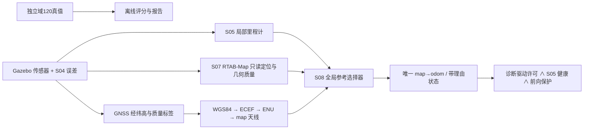

# S08 技术原理与落地边界

本步采用“全局主参考选择 + 独立一致性监督”，而不是把所有位姿反复投入另一个 EKF。S05 保持连续 odom→base_link；S07 提供冻结地图中的 RTAB-Map 观测；S08 是本阶段唯一 map→odom 发布者。S07 原管理器在 S08 会话中不启动，原阶段入口仍可独立复验。新实现放在 gnss_supervisor 包，避免改动已冻结的 global_pose_manager 使前置证据失效。

## 数据流与坐标

GNSS datum 为 WGS84 `[31.2304°,121.4737°,10m]`，高度是椭球高，ENU 为东、北、天。复用 S04 已有椭球 ECEF 数学，避免经纬度直接当米。`gnss_alignment.yaml` 声明三个仿真场地控制点，SVD 解二维刚体旋转和平移，高程只作平移；三个点须非共线，拟合最大残差不得超过 5cm。它们是**仿真场地测量先验**，不是从本轮车辆真值或评分轨迹拟合得到的实测标定。实车部署须独立测量对应控制点。

`p_map_antenna = R_map_ENU × R_ENU_ECEF × (ECEF(LLH) − ECEF(datum)) + translation`。

NavSatFix 协方差在测量点局部 ENU 中，先旋转至 datum ENU 再到 map：`C_map = J C_fix Jᵀ + σ_translation² I + j_yaw j_yawᵀ σ_yaw²`。配准平移标准差 0.02m、航向标准差 0.001rad 是声明的仿真先验预算，不是本轮拟合置信区间。天线相对 base_link 安装位置 `[-0.1,0,0.8]m`，由当前经过验证的车身姿态旋转后扣除：`p_base = p_antenna − R_map_base × lever_arm`。

单天线静止时不提供航向，IMU 本身也没有绝对方向输出。本步初始航向依赖冻结地图匹配与粗操作员初值；初始化必须有至少三次一致地图观测、跨度 1.5s，并得到连续合格 GNSS 的一致性确认。之后短时缺图可使用 S05 相对旋转传播，最长 8s，超过即停车。不能在长期无地图区域仅凭一个 GNSS 天线持续自主行驶。

## 选择逻辑与解释

| 状态 | 依据 | 诊断最大速度 |
|---|---|---:|
| INITIALIZING / CONFIRMING | 定位或恢复证据不足 | 0 |
| TRUSTED_MAP | 地图几何合格，GNSS fixed/协方差/创新合格 | 0.12m/s |
| MAP_ONLY | GNSS 失锁、float 或创新被拒；近期地图仍合格 | 0.06m/s |
| GNSS_ONLY | 地图暂不可用，GNSS 合格，航向年龄 ≤8s | 0.06m/s |
| STOPPED | 双源失效、航向过期、时间/版本故障、跳变锁止 | 0 |

GNSS 必须通过正定协方差、位置年龄 ≤0.6s、二维最大方差 ≤0.01m² 等检查；`fixed` 标签本身不授予可靠性。创新为 GNSS 基座位置减去由最近全局参考和同时间局部里程计预测的基座位置。使用 `S=C_GNSS + 0.0025 I`，`NIS=rᵀS⁻¹r`；同时要求距离 ≤0.15m、NIS ≤9.21。9.21 是二维卡方 99% 的工程起点，参考误差不完全高斯、GNSS 有相关噪声，不能把它宣传为真实漏警率证明。

地图观测先经过 S07 几何/时间/协方差门控，再与当前 correction 和独立 GNSS 比较。地图跳变超过 0.15m 或 0.035rad 就锁止，保留原观测、原跳变量和拒绝理由。地图与 GNSS 冲突时不能仅凭两路差异确定谁错；本版保留已验证连续参考，拒绝不一致候选或短时降级，无参考可用就停。缓慢共同漂移、两源共同偏移和很小的渐变多径仍可能漏检，需更多独立航向/地图质量证据。

`T_map_odom = T_map_base × inverse(T_odom_base)`，按观测原始时间找最近局部里程计（差≤0.05s），不修改原始测量时刻。地图为主时直接采用合格 correction；GNSS 接管时仅对 XY correction 做 0.3 比例的平滑，不更新绝对航向，不以平滑降低协方差冒充增加独立样本。S05 与 RTAB 观测相关，因此没有再把地图位姿与 S05 当独立量融合；GNSS 从未作为 RTAB 强先验又重复当独立验证。

## 停车、恢复和版本

保持局部里程计 ≤0.25 仿真秒 / 0.5 现实秒新鲜度；时钟停止 0.6 现实秒后关闭许可，时钟倒退要求新会话。地图合同心跳必须 ≤0.6 仿真秒 / 0.8 现实秒；配准侧车变更使合同失效。地图有效观测年龄≤1.5s。速度控制还同时受 S05 健康和原前向制动净空约束。

普通失效恢复需至少三次不同时间的证据、持续1.5s，并确认实际静止（|v|<0.01m/s、|w|<0.02rad/s）。地图跳变锁止还需要重新验证；当前无真实工作计划的诊断 fixture 通过专用服务确认。未来 S12/S14 必须关联真实计划版本并重新准入，不能直接用这个诊断确认恢复割草。

输出 Pose 协方差是保守工程预算（非统计校准滤波协方差），失效时置高并保留明确状态。TF 存在不代表可以运动；消费者必须读取 `/s08/status` 的许可和原因。

## 实际测试与限制

正式矩阵包含正常、GNSS 遮挡/float、错误 fixed/双失效、地图短暂退化/错误匹配。实际仿真传感器经正常处理后在观测边界注入故障；这验证监督与执行链，未模拟射频传播、多路径物理或训练视觉误匹配分布。独立真值只供离线评分，固定 map 原点 `[28,14,0]`，不做逐段对齐。正常与故障场景均保留全部已发布位姿误差以及准入窗口误差，未初始化阶段记录无位姿与等待时间。

S07 冻结图连接路/B区已有约0.8/1.3m RMSE的局部畸变，刚体 GNSS 配准不能修复。这次正常精度验收针对 A 区。不能把 S08 通过等同于两个作业区的全覆盖精度已达标；正式跨区精细作业前需要地图修订和链式复验。

没有新装系统软件，继续用已锁定 ROS2 Jazzy、RTAB-Map、robot_localization、Eigen 和 NumPy/SciPy。相比直接启用 navsat_transform，本项目适配明确处理控制点、天线杆臂、质量标签和保守选源，代码较短；代价是需要维护和测试这一适配，不是双天线惯导或商业 RTK 系统。

## 上游依据

- [robot_localization GPS 集成文档](https://raw.githubusercontent.com/cra-ros-pkg/robot_localization/jazzy-devel/doc/integrating_gps.rst)：GPS 跳变、连续局部估计与地理坐标/航向输入职责。
- [REP-105](https://raw.githubusercontent.com/ros-infrastructure/rep/master/rep-0105.rst)：map、odom 的连续性与职责。
- [Jazzy NavSatFix 定义](https://raw.githubusercontent.com/ros2/common_interfaces/jazzy/sensor_msgs/msg/NavSatFix.msg)：WGS84、天线帧、局部 ENU 协方差。

原项目 tf_fault_proxy.py、scan_quality.py 和 estimator_guard 测试实际存在，已读其单出口、几何质量、时间失效思路。其旧测试不冒充本轮 S08 测试；本步以新生产 C++ 节点与实际 Gazebo 证据重新验证。

初始 GNSS 不可用时，本版 S08 即使已有地图候选也不授予运动许可，这是保守启动限制；S07 的地图定位能力本身未删除。8s 航向预算以 S04 的约0.002rad/s固定偏置作初估，8s积累约0.016rad，再为匹配误差与噪声留余量；它是经组件失效测试的工程限制，尚非实车误差统计保证。当前0.12m/s诊断速度下，单天线位置差分的航向噪声较大，因此没有把 GNSS 运动方向冒充可靠绝对航向。
