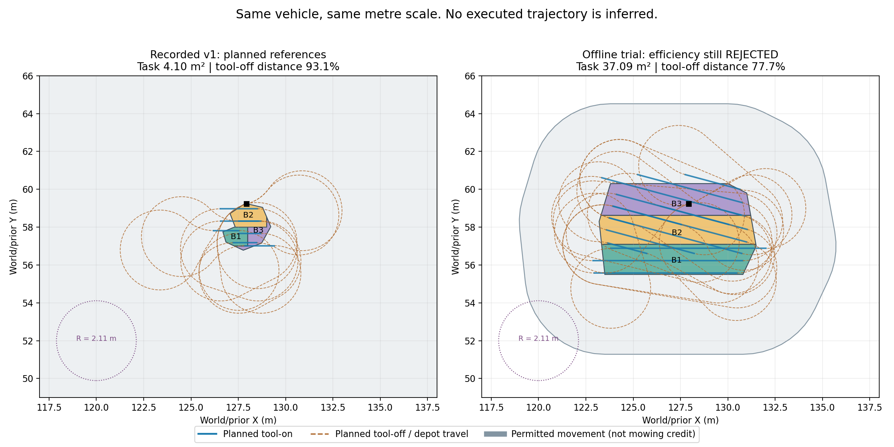

# 阿克曼割草半径与场地尺度核查

结论：截图反映了真实的设计不匹配。当前车辆的转向几何自洽，但旧演示为了缩短时间，把任务区缩得过小，不能用它代表正常商用条带割草。问题同时涉及任务尺度、前进式连接、每簇独立进出场，以及小地图没有解释参考线。**本轮修正了显示并建立可复现的设计检查；运行中的割草路径方案尚未完成替换。**

本核查不启动仿真，不增加上一轮 179.2 分钟的录制消耗，不改变 S17 PARTIAL，不执行 S18。保留原正式地图、正式任务、v1 演示、全部原视频和原验收标准。

## 车辆到底多大、转弯多大

| 项目 | 当前实际配置/证据 |
|---|---|
| 轴距 / 轮距 | 1.00 m / 0.70 m |
| 车体盒尺寸 | 1.50 × 0.80 m；不是完整碰撞外包络 |
| 规划车身包络 | 1.60 × 1.04 m，后轴中心前方伸出 1.30 m |
| 刀盘物理宽 / 虚拟有效割幅 | 1.00 m / 0.90 m |
| 单个转向关节上限 | 0.60 rad，约 34.38° |
| 控制曲率上限 | 0.5 m⁻¹，对应后轴中心半径 2.00 m |
| S03 仿真实测左右最小半径 | 2.000020 m / 2.000005 m |
| 路径规划最小半径 | 2.11 m |
| 后轴中心整圈直径 / 车身外缘整圈直径 | 4.22 m / 约 5.87 m，后者尚未加安全余量 |
| 实物标定 | NOT_CALIBRATED；目前是通用仿真底盘 |

`base_link` 在后轴中点，不能把“转弯半径”误当成整车占地半径。左右轮独立转角满足阿克曼几何。对内轮关节极限，应计算 `R = L / tan(δ_inner) + track / 2 ≈ 1.812 m`；不能直接把 0.6 rad 当成单轨模型的虚拟前轮角。当前控制限幅又把半径收紧到 2.0 m，规划再留至 2.11 m。因此没有发现半径单位、弧度/角度或半径/直径配置错误。

车身外缘整圈直径按 `2 × max(hypot(x, y−R))` 计算。它用于理解扫掠尺度，不等于每种掉头都需要一个完整圆，也不是行业统一的地头宽度标准。规划实际仍逐段检查带余量的完整车身扫掠。

## 与实际设备的关系

割草设备并不只有一种底盘。Kubota BX2380 官方规格列出轴距 55.1 英寸（约 1.40 m）、转弯半径 7.5 英尺（约 2.29 m）；BX 系列支持中置割草附件。它说明拖拉机式设备出现米级转弯尺度并不异常，但体型、重量及厂家半径测量口径不同，**不能据此宣称当前 1 m 轴距模型已复刻该实车**。[Kubota 官方规格](https://www.kubotausa.com/docs/default-source/sales1source/bx2380-detailed-specifications.pdf)、[BX 系列及割草附件](https://www.kubotausa.com/equipment-series/bx-series)

Toro 的 Z Master 设备则属于零转向割草机。另一份 Toro 操作说明明确描述独立后驱轮与快速转向能力。它们不等同于本项目的固定后轴、前轮转向阿克曼结构。不能只把 Nav2 半径改成 0 或 0.5 m，就认为获得同等能力。[Toro Z Master](https://www.toro.com/en/product/77288)、[Toro 官方驾驶说明](https://www.toro.com/getpub/126514)

本项目宜明确定位为“通用阿克曼作业车的功能仿真”。如果目标是紧凑家用机器人或零转向商用割草机，应另设符合目标设备的底盘配置，并重新验证动力学、轮胎、转向、工具包络和停止距离。

## 截图中的大圈从哪里来

正式 B 区可通行多边形约 1120 m²；当前正式任务已经是其中约 45.6 m² 的独立任务域。录制 v1 又把该任务的两个方向各缩到 0.30 倍，面积变为原来的 0.09，即 **4.104 m²**。三个簇约为 1.113、1.918、1.073 m²，整个任务包围框仅 2.53 × 2.48 m。

| 旧演示 | 开刀参考长度 | 关刀参考长度 | 关刀里程占比 |
|---|---:|---:|---:|
| B1 | 2.60 m | 41.25 m | 94.1% |
| B2 | 3.92 m | 44.35 m | 91.9% |
| B3 | 3.92 m | 54.46 m | 93.3% |

这里统计的是冻结离线路径，包含转弯和进出场；不是视频估计里程，也不是在线绕障总里程。三个任务合计约 93.1% 的参考里程用于关刀移动。条带长约 1–2 m、间距 0.65 m，却要用最小直径 4.22 m 的前进式 Dubins 曲线换行，并逐簇回到固定起终点，出现大圈有明确几何原因。它不是仅凭截图就能诊断的“控制器震荡”。

Fields2Cover 官方把条带排序和地头路径单独设计，提供普通往返、跳行等方式；跳行有助于减少急转弯，但在极小地块中仍不能突破车辆几何约束。本项目原有 Held–Karp 已允许改变条带顺序，因此不能声称“新增一个排序算法”就一定消除问题。[Fields2Cover 路由说明](https://fields2cover.github.io/source/tutorials/route_planning.html)

图中的彩色区域是任务记账区，并不代表完整允许行驶的边界；旧灰线是所有预规划段，也并非已经行驶的轨迹。任务区外若是明确授权的转场带，可以关刀通行；若真实场地那里是围墙、沟渠或道路，则必须算作不可进入区域。不能靠“图上没有画边界”默认允许越界。

## 本轮落实与未通过的部分

1. 后续录制的小地图加入米制比例尺、许可通行区局部底色，以及“计划空驶 / 计划作业 / 实测车辆 / 反馈确认作业”的明确图例。旧录像不重写。`inset_preview.png` 使用原 B1 运行末帧的真实监视和账本快照重绘，仅是新版显示预览。
2. 新增 `mower_geometry_audit.py`，从配置和冻结任务直接计算半径、扫掠直径、任务面积及空驶占比。任务最长边小于转弯直径或任一簇关刀里程超过 75% 时给出设计警报。**75% 是本项目用于拒绝明显不合适演示的工程门槛，不是行业标准，也不是达到门槛就足够高效。**
3. 建立独立离线候选 `mower_scale_v2c`：37.095 m² 的连续不规则凸多边形，按累计面积二分求出三个相邻连通簇，各约 12.365 m²。在本次近似均匀工作量下，面积与直线作业工时成比例；转弯和开关刀时间另用完整路径计算。该划分算法只接受凸区域，凹区域应使用原 METIS 或先分解，不能把本例推广为任意场地的通用解。
4. 新候选通过车身扫掠、曲率/速度、覆盖率、连通性、路径连续性及版本绑定检查；预计三个簇约 16.4、21.9、22.8 分钟，均低于 30 分钟。时长仅为离线估计，实际反馈、避障、等待和重试仍须计入实测任务时限。
5. **新候选仍未达到展示设计要求**：关刀里程合计约 77.7%。扩大任务改善了尺度，但局部观测可用区域、窄簇、起终点与前进式连接仍限制效率。另一次有界中间点连接试验没有改善最终选中路径；保存此结果，不宣称算法收益。候选保持 `online_execution_allowed=false`、`closed_loop_status=NOT_RUN`，不是新运行默认任务。



三维场景能表达不规则边界、地形、障碍与传感器观测；当前割草仍是抽象工具动作和几何账本，不模拟真实草叶切削、草高负载、轮胎在湿草上的牵引变化。现行定位/工具链的速度上限约 0.12 m/s，是保守验证配置，不能用它估算商用设备生产效率。当前场景是功能验证环境，尚不能称为完整商业割草数字样机。

## 后续修正方向

优先保留当前阿克曼几何，将演示条带的长度提高到约 20–25 m 量级，并在原 B 区内明确声明工作草坪、地头/转场带、禁止进入区。面积、条带方向、地头、分簇、起终点需要联合考虑，不能把地块缩小作为唯一压时办法。应先扩展可用定位/观测覆盖、验证完整包络，再比较跳行、环形及短转弯连接；每簇仍保留完整工时上限。

按 22 × 9 m 量级举例，连续任务约 198 m²、每簇约 66 m²。以 0.65 m 条带间距和 0.12 m/s 计算，理想直线工时约 14.1 分钟/簇，尚未计入转弯、工具反馈及等待；这只是选尺度的预算起点，**不是已生成、已碰撞验证的路线或完成承诺**。原 B 区面积允许研究这一尺度，但当前局部配准观测范围不支持直接宣称所有转弯区域已知安全。

全草坪覆盖还必须明确地头草坪的补割义务。可以把地头作为单独末尾覆盖阶段；不能把其从覆盖分母删除后声称整个草坪完成。若场地狭窄，需评估停车换向的 Reeds–Shepp/Hybrid-A* 和可倒车控制闭环；倒车能力、换挡、停刀、后向感知须单独验证。目前不直接启用。没有合法路径时继续停车、保存账本、报人工，而不是无限绕圈或缩小车身。

## 手工检查

在开发机执行，不启动 Gazebo：

```bash
cd /home/ceihao/robot_project
source optimization_v2/env.sh
export OPENBLAS_NUM_THREADS=1 OMP_NUM_THREADS=1
optimization_v2/venvs/scene/bin/python optimization_v2/ws/src/showcase_demo/scripts/mower_geometry_audit.py
xdg-open optimization_v2/showcase/mower_geometry_review/scale_comparison.png
xdg-open optimization_v2/showcase/mower_geometry_review/inset_preview.png
optimization_v2/venvs/scene/bin/python optimization_v2/ws/src/showcase_demo/tests/mower_geometry_contract.py
```

预期：物理约束自洽；候选几何检查均为 true；同时保留 `TOOL_OFF_DISTANCE_DOMINATES_OVER_75_PERCENT`；6 个回归检查通过。不要把几何 PASS 看成设计和实际运行 PASS。

可单独验证严格设计门槛：

```bash
optimization_v2/venvs/scene/bin/python optimization_v2/ws/src/showcase_demo/scripts/mower_geometry_audit.py --require-representative
echo $?
```

当前预期退出码 **3**，明确拒绝把该候选当作已解决的代表性割草方案。历史 v1 的功能任务 PASS 仍有效，但没有证明其效率和商用代表性。

核心代码：`chassis_bridge/scripts/kinematics.py` 计算实际左右轮角度；`robot_description/scripts/generate.py` 把后轴与前轮关节落实进 SDF；`mower_geometry_audit.py` 做尺度核查；`mower_scale_candidate.py` 生成独立任务与累计面积分簇；`scale_routing.py` 是本次实验副本，使用 F2C 条带、有限方向图 Held–Karp、Dubins 和有界中间点尝试。没有改动冻结的 `routing14.py`。新功能没有新增 C++ 底盘算法；仍复用已构建 F2C 后端和原底盘控制实现。

下一步判断：**可以继续开展割草场地与路线修正；暂不能把新候选替换为正式/录制默认任务，不能宣布该问题已完全解决，不能进入 S18。** 建议续接指令：“根据割草转弯半径与场地尺度核查，优先修正长条带、地头和三簇路由；先补齐对应区域定位与观测资格，降低空驶占比，通过离线设计门槛后再做有界单簇实测。保持正式标准和旧录制不变，不自动执行 S18。”
