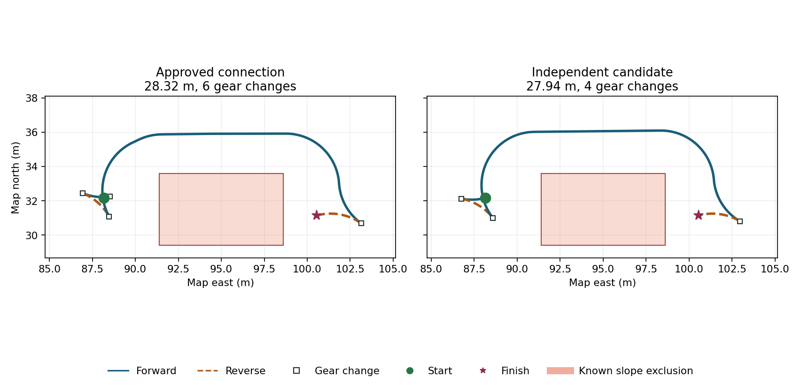

# B1 地头第六个关刀连接的实测与离线备选

B1 正式复验行驶到第六个地头连接的第 4 个单挡段 `B1:safe_turn:6:3`，后来因定位证据不足停车并请求人工。这里比较的是两条作业条带之间的完整关刀连接。车辆在两端的位置和航向不能改，前后均为正向开刀，车体最小转弯半径、坡面和边界条件全部沿用当前批准版本。[正式整簇分析](../../validation/closeout_20261119/runs/mowing_20261119_072044_764057/analysis_mowing_r10.json)

|离线几何指标|当前正式连接|独立备选连接|
|---|---:|---:|
|路径长度|28.32 m|27.94 m|
|其中倒车路程|5.19 m|4.67 m|
|关刀单挡段数|5|4|
|含前后正向作业的换向次数|6|4|
|最短单挡段|0.38 m|1.41 m|
|规划用扩大车体与授权边界的最小采样净距|2.01 cm|7.69 cm|

净距是车体已经加上栅格、位姿和跟踪余量后的额外空间。它的采样间隔最多 4 厘米。对每段定曲率运动，用弧长和最外侧车体角点的旋转位移约束采样之间的移动，可以保守证明候选的扩大车体全程还剩至少 **3.40 厘米**。同一保守算法对原线路得到负下界，只说明该下界不足以证明更大余量。原批准版保留原先的碰撞检查和资质。两条线路都只使用事先批准的坡面及边界。动态障碍、定位质量和实时可见度仍由运行时判断。

## 复核与重新搜索

在项目根目录、按构建说明编译过原 OMPL 后运行。第一条读取完整批准路线、车体包络及原始 B1，再把备选连接插入位于内存中的路线副本，调用项目同一个完整几何验收器。原十个开刀片段逐项相同，原目标并集仍为 188.3918 m²。第二条实际调用相同的 C++ 后端重做该次搜索，输出路径请选用尚不存在的文件名。

```bash
optimization_v2/venvs/scene/bin/python optimization_v2/three_tasks/late_connector.py
optimization_v2/venvs/scene/bin/python optimization_v2/three_tasks/late_connector.py \
  --regenerate /tmp/B1_late_connector_candidate.json
optimization_v2/venvs/scene/bin/python -m unittest discover \
  -s optimization_v2/three_tasks -p test_late_connector.py
```

本次按两种搜索方向在固定端点之间进行有界 OMPL Reeds–Shepp / RRTConnect 搜索。选择向前搜索种子 877 的轨迹，采用 1.5 秒求解时限。与原连接相比同时获得更少换向、更长的最短单挡段、更大的额外净距及更短总路程。候选不写入任务配置，离线估时由 1,247.12 变为 1,240.61 仿真秒，实车耗时与作业面积需要另行测量。本机用同一原生二进制和种子重生成，与发布候选 SHA-256 一致。[路径与种子](../../optimization_v2/three_tasks/candidates/B1_late_connector.json) · [八项完整几何复核](../../validation/closeout_20261119/B1_offline_connector.json) · [比较算法](../../optimization_v2/three_tasks/late_connector.py)


另一个种子 823 也取得四个单挡段，但需要倒车 24.37 m。对比后增设了倒车路程不得超过原连接的选择条件，种子 877 同时保留少换向和以正向为主的行驶方式。[未采用方案与逐项对照](../../validation/closeout_20261119/B1_long_reverse_comparison.json)

## 原生导航服务实测

Jazzy 的原生 Nav2 地图与规划服务器分别检查了四个单挡段。逐段调用 `IsPathValid`，正常栅格返回可行，在该段中点注入致命障碍栅格后返回不可行，撤去障碍后恢复可行。测试使用冻结地图、真实 Smac 与独立 ROS 域，TF 和障碍输入由测试提供。在 Gazebo 中驾驶这条备选路径仍需单独运行。[四挡原生服务回执](../../validation/closeout_20261119/B1_connector_nav2.json)

复现四挡服务测试可在已构建的开发机输入以下命令，输出文件另存至临时目录。

```bash
source optimization_v2/env.sh
optimization_v2/venvs/scene/bin/python \
  optimization_v2/ws/src/task_platform/scripts/probe_nav2_paths_candidate_r10.py \
  optimization_v2/three_tasks/candidates/B1_late_connector.json \
  --gear-prefix B1:offline_connection:6 --out /tmp/B1_nav2_connector.json
```



蓝色实线表示前进，橙色虚线表示倒车，空心方块是连接内部换向位。表中换向次数还包含进入和离开连接时与正向作业的衔接。
