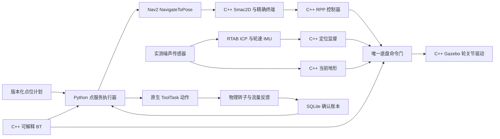

# R07 核心代码

新增代码位于 `optimization_v2/ws/src/task_platform/scripts/`。实际结果见本目录 `RESULTS.md`，命令见 `MANUAL.md`。

- `prepare_r07.py`：保留 R03 全部点序列并绑定新版本；生成独立 Nav2、工具、地形和定位配置。通过断言检查上游 C++ 源码后生成适配代码，不修改原实现。
- `scene_r07.py`：只在仿真组装边界设置车辆初始位置、近地传感器和抽象工具；在线节点不导入此文件。
- `sources_r07.py`：对齐 GNSS 消息与质量描述，转换 ENU 和每车天线杆臂，检查配置不变，向原生 S08 监督器提交观测；不发布 TF。
- `reference_r07.py`：转接原生监督器结果；使用已验证的地图/里程计参考，不生成第二份全局估计。
- `near_r07.py`：主/近地点云与局部里程计的异步配对和运动补偿；缺数据时拒绝输出，不填造点。
- `risk_r07.py`：当前地形与公开边界生成局部代价；未知不当作空闲，保留实测危险。
- `control_r07.py`：唯一底盘请求发布者；同时检查树指令、任务状态、定位、感知、工具停止、命令与时钟。停车检测直接使用局部实测速度，不依赖全局定位先成功。
- `mission_r07.py`：顺序动作客户端；到点、等待停车、调用工具、确认账本，响应树的取消请求，有限次重试并保留残余。
- `tool_observer_r07.py`：将估计位姿和真实仿真工具反馈送入原账本；目标是否需要药剂处理暂为任务给定条件，未来由独立机械臂/近景视觉项目替换。
- `analyze_r07.py`：独立真值域事后检验停车、接触、喷洒位置、实际剂量与账本是否一致。

实际 C++ 路径：Nav2 SmacPlanner2D/RPP（DWB 为待独立复验的备选） 和 BT Navigator；已有 `gnss_supervisor.cpp`；S14 地形核心；BehaviorTree.CPP 公共树；`tool_sim/src/action_server.cpp` 与 `ToolActuator.cc`。Python 负责配置、时间对齐、事务编排和评估，实际底盘和工具反馈不是 Python 直接设置位置得到的。

## 本轮关键适配

- `r07_nav/exact_goal.cpp`：继承原生 SmacPlanner2D；格点搜索后对精确末端进行足迹检查，小于 4.0 m 的直连也经过同一检查。未知/致命代价或取消请求直接拒绝，不能凭距离近直接穿过障碍。
- `overlay_r07.py`、`guess_r07.py`：点云保留立面结构和适量地面；独立轮速/IMU 只提供 ICP 初值，私有 TF 不增加 `/tf` 发布者。
- `map_inputs_r07.py`：地图匹配按雷达采集时刻插值里程计、做时间稳定性过滤，不等待未使用的相机配对。
- `near_r07.py`：近地新扫描触发，按观测时间进行 SE(3) 补偿；缺少远距点不假设自由空间。
- `tool_observer_r07.py`：用实际里程计时刻和准入地图修正生成工具估计位姿。`ledger_r07.py` 只增加有界反馈配对缓存，调用原 `Ledger` 完成事务、拒绝过期数据和幂等记账。
- `control_r07.py`：记录独立定位/感知年龄及完整准入原因；运动进展包含实测转角，作业完成量仍只来自工具反馈。

- `overlay_r07.py`：ICP 窗口中点时戳、窗口一致的轮速创新及协方差 NIS；保留原停止冲突和质量门。
- `regional_r07.py`：已准入 map→odom 修正的有界稳健过滤，原始匹配与 GNSS 检查仍先执行。
- `tests/test_alignment_r07.py`：直接实例化生产适配器验证时间窗口与滑移判据，不另写一份相似算法作为测试替身。

- `r07_nav/terrain_observations.hpp`：生产地形调用的三帧观测过滤器；`test_terrain_r07.py` 编译同一头文件验证噪声尖峰、立即危险、持续小台阶、过期和时间回退。
- `test_unknown_r07.py`：在隔离 ROS 域 126 启动原生产代价层，确认严格 RPP 策略下未知和过期区域仍输出未知。

- `mission_r07.py::settle_and_redock`：实际停车后等当前观测稳定，必要时有限次重新导航停靠；不改估计位姿，不清零已确认剂量。
- `r07_nav/exact_goal.cpp`：经足迹检查的邻近直连按 5 cm 采样，避免稀疏两端点误导 RPP。`test_planner_r07.py` 调用真实 Nav2 action 和已安装插件，校验路径及阻塞拒绝。
