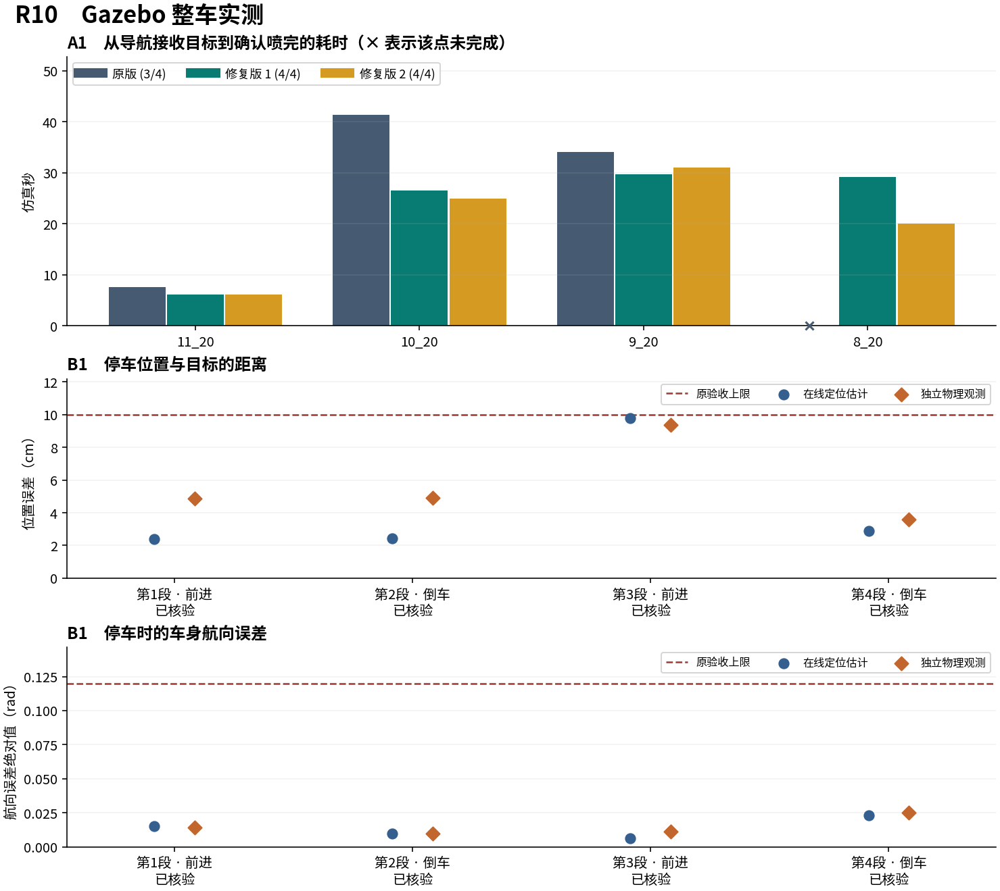

# R10 连续点喷与四段换向实车仿真复验

本页记录同一台 Ubuntu 24.04 主机上独立运行的两个 Gazebo 实验。点喷以真实计量反馈和 SQLite 账本结算。割草车在关闭刀盘的情况下验证四段换向连接，每段的停车位置与航向由独立的物理观察器复核。[本轮证据目录](../../../validation/r10_continuation_20261119)

## A1 连续精停

四个目标依次为 `point_11_20`、`point_10_20`、`point_9_20`、`point_8_20`，均为原 A1 中相邻的真实作业点，每点请求 3.0 单位。独立场景从第一个目标起步，冷启动以有偏粗初值获取地图定位。第一点没有站间行驶，因此工时比较另列从第一个点喷完到第三个点喷完的同工作量耗时。

原版在同一物理场景按顺序确认 3/4 点，最后一站进入人工处置。部分点云先于同采集时刻的里程计到达。地形节点据此发布时间配对失败，BT 取消导航，有时也中断已开始的喷洒。修复版使用容量为一的待配对点云，在里程计到达或定时器触发时复查，最多等待原 50 ms 配对窗口。过龄、时间异常和真实障碍依旧能阻止作业。精停时并行积累机械稳定时间与有效静止定位样本，定位跳变、数据间断或车辆移动均清空窗口。喷洒仍要求至少 20 个观测，跨度至少 1.8 s、最大采样间隔 0.15 s、中位位置误差至多 3.5 cm、最新误差至多 4.5 cm、位置散布 P95 至多 1.5 cm。车辆与工具均要确认停车。局部运动只提出纠偏，喷洒必须再次通过全局检查。[点云时间配对](../../../optimization_v2/ws/src/task_platform/r10_backend/terrain_pairing.inc) · [精停观测窗口](../../../optimization_v2/ws/src/task_platform/scripts/spray_precision_r10.py) · [连续作业入口](../../../optimization_v2/ws/src/task_platform/scripts/spray_precision_session_r10.py)

|同场独立冷启动|账本确认|任务关闭时刻（仿真 s）|第一个点喷完至第三个点喷完（仿真 s）|地形里程计配对失败|感知触发的取消指令|
|---|---:|---:|---:|---:|---:|
|原版对照|3/4|156.448|75.352|18|15|
|修复版一|4/4|128.164|56.048|0|0|
|修复版二|4/4|120.242|55.818|0|0|

两次修复版都通过了逐点真实流量、幂等重放、零意外接触和最终双停检查。第二次冷启动中，四个喷洒点在实际出液时的最大物理位置误差分别为 0.00、0.54、3.71、3.65 cm。两次修复版是按顺序演进的软件版本，第二版同时补强时钟回退和受限的全局重新接近。两次测量可以证实两版均完成同一工作段；它们不足以估计单一版本长期的成功率。[逐点时间、剂量、门限和录像清单](../../../validation/r10_continuation_20261119/a1/comparison.json) · [对照片和修复版实录](../../../media/r10_continuation_20261119/README.md)

整簇原序复跑选中全部 56 点，本次账本确认 **26/56**，30 点未结清，终态时刻 **978.792 仿真秒**。执行器记录为 `TimeoutError('TASK_BOUND_OR_STOP_REQUEST')`。该次运行在本轮现实时间边界内请求双停。

只比较两个版本均按原序确认的前 22 点，从第一个点喷完到第 22 个点喷完，此前整簇版本用了 862.112 仿真秒，本次用了 777.130 仿真秒。这项同工作量比较包含站间等待、定位恢复和工具重试。[整簇逐点反馈](../../../validation/r10_continuation_20261119/a1/full_selection.json) · [同工作量工时复算](../../../validation/r10_continuation_20261119/checkpoint.json)

另对全簇 56 个目标做了离线点序比较。固定首、末点，对原点序和横、纵向条带点序做路径反转与单点移位搜索，以行驶距离除以 0.30 m/s，加上累计转角除以 0.35 rad/s 作为排序代价。每条直连边都检查原先验内的整车外接圆和安全余量。去掉相同的 3 m 回库尾段，两条路线分别长 167.49 m 和 169.97 m，累计转角由 50.27 降到 31.42 rad，运动代价由 701.90 降到 656.33 s。这个量仅用于比较路线，真实任务还含停车、定位、工具和恢复时间。本轮整车点喷使用原点序。[56 点候选及原数据哈希](../../../optimization_v2/three_tasks/candidates/A1_time_order.json)

## B1 四段换向

seed 877 路径总长 27.94 m，四个关刀行驶段分别对应前进、倒车、前进、倒车。车辆从连接段入口冷启动，定位器只获得有偏的粗略初值。每次换向先验证停车和刀盘停转。位置容差为 0.10 m，航向容差为 0.12 rad（约 6.88°），停稳窗口至少 15 个有效样本并覆盖 0.60 s，最大间隔 0.15 s。停车误差以所需的车身朝向为准，倒车时也保留同一套车身坐标定义。报告还给出沿行驶方向的过冲量、相对车头的横向误差、地图定位误差与独立物理位置误差。关刀走完连接段不会增加割草面积。[实车实验入口](../../../optimization_v2/ws/src/task_platform/scripts/qualify_b1_context.py) · [独立停车评分](../../../optimization_v2/ws/src/task_platform/scripts/score_b1_connector.py)

启动定位的候选修复在点到平面的 ICP 拟合中保留距离较小的 60% 训练对应点，并对较大残差降低权重。每帧保留独立的验证点，多初值比较用于检查位姿歧义。另一段原 B1 运行的 67 个实测激光帧中，通过 15 cm GNSS 一致性对照的帧数由 35 增至 66，对独立物理位置的误差中位数约由 14.0 降至 2.1 cm。这些数字是历史数据回放，四次停车须另看实际驾驶。[保留路段逐帧记录](../../../validation/r10_continuation_20261119/b1/registration_replay.json)

前两次出车暴露了不同的问题。首次冷启动已能定位，地形节点却因点云和里程计到达顺序重复取消导航，车辆安全停车转人工。第二次仅将配对逻辑移植到阿克曼专用的 R09 地形节点，保留了 Dino 车体自遮罩和近障观测。该轮第一段原轨迹及停车通过；第二段最终停车在 距目标最多 5.14 cm、航向误差最多 0.11995 rad，但使用了多挡恢复动作，轨迹资格未通过。第三段多次遇到感知等待和短障清空，任务在 207.902 仿真秒结束。[首次出车](../../../validation/r10_continuation_20261119/b1/initial/physical_connector_report.json) · [配对修复版](../../../validation/r10_continuation_20261119/b1/capture_time/physical_connector_report.json)

换向处的前轮要从一侧转向另一侧。原底盘允许转角未对齐时以 0.10 m/s 爬行；第二段在车头仍偏转时已经倒车，终点的主要误差来自侧向。第三版调用原底盘的转向对齐互锁，对齐期间轮速置零。Nav2 仍决定速度和执行碰撞检查，跟踪器从相邻路径姿态估计参考曲率，并用在线横向误差、航向误差作校正，对最终命令再次做足迹碰撞预测。追踪的内部目标收紧至 2.5 cm 和 0.04 rad。长段受到短暂中断后，只有实际定位证实沿路径前进足够距离才重新累计连续重试次数，每段另有总中断和时限约束。[转向跟踪器](../../../optimization_v2/ws/src/task_platform/r10_connector_nav/controller.cpp) · [版本生成与进展判断](../../../optimization_v2/ws/src/task_platform/scripts/qualify_b1_steering.py)

第三版四个物理停车目标均在原门限内，前三段沿指定路线和挡位完成。第四段在收到上一段留下的重规划指令后，走了替代路线。第四版为非紧急行为树指令增加了当前段 ID、挡位、决策时间与传感器采集时间的一致性检查。遇到紧急停车、人工介入或定位恢复仍立即处理。[当前作业段的指令匹配](../../../optimization_v2/ws/src/task_platform/scripts/qualify_b1_context.py)

第四版在 228.312 仿真秒内走完四个单挡段，物理评分器的 17 项检查全部通过。以下位置与航向取各次停车观测窗内的最大物理误差。地图定位平面 RMSE 为 2.62 cm，驱动和刀盘最终双停，无异常接触，刀盘全程关闭。[四段原始评分](../../../validation/r10_continuation_20261119/b1/physical_connector_report.json)

|行驶段|路径长度|有效停车定位样本|窗口跨度|位置误差上界|航向误差上界|
|---|---:|---:|---:|---:|---:|
|第 1 段 · 前进|1.415 m|22|0.630 s|4.87 cm|0.01400 rad（0.80°）|
|第 2 段 · 倒车|2.196 m|21|0.600 s|4.90 cm|0.00957 rad（0.55°）|
|第 3 段 · 前进|21.853 m|21|0.602 s|9.38 cm|0.01105 rad（0.63°）|
|第 4 段 · 倒车|2.475 m|21|0.602 s|3.57 cm|0.02504 rad（1.43°）|

从成功出车会话重建的完整 B1 候选共 46 段，45 个相邻接缝通过离线检查，路径全长 227.653 m，规划估时 1240.61 仿真秒。原任务有 9 项割草义务。已批准的安全版本从其中 8 项生成 10 个可执行割草片段，原第 33 段仍有显式残余。候选完整保留这些作业片段及 188.3918 m² 原始作业面积分母。此次整车实际行驶的范围是四段地头连接，46 段整簇的实跑状态为 `NOT_RUN`。[整簇几何与作业范围复验](../../../validation/r10_continuation_20261119/b1/full_plan_preflight.json) · [完整候选任务文件](../../../validation/r10_continuation_20261119/b1/mission_46.json.gz)

第三段距 10 cm 的验收上限只余约 6 mm。这次实测证明四段均能完成，重复运行的成功率仍待测定。下图展示点喷各站的周期和 B1 各段停车时刻的估计值与物理值，虚线为原门限。



## 手工复验

在已通过 R09 前置检查的项目根目录执行。两种 Gazebo 任务共用一把会话锁，须顺序运行。新机器先按构建说明恢复资产和本机前置。[环境和依赖](../../../BUILDING.md)

```bash
# 复跑原 A1 中从第 22 个目标开始的连续四点，--first-index 从 0 数起
bash optimization_v2/three_tasks/advance.sh R10 experiment spray_precision run --first-index 21 --count 4 --seconds 300 --rtf .55

# 驱动真实阿克曼仿真底盘走四段换向，逐段用独立位置和航向证据评分
bash optimization_v2/three_tasks/advance.sh R10 experiment mowing_four_gear run --rtf .55 --seconds 390

# 只做离线重算与比较，不启动 Gazebo
bash optimization_v2/three_tasks/advance.sh R10 experiment spray_time_order --check
python3 optimization_v2/three_tasks/r10_checkpoint.py

# 观察完整 56 点任务的原点序、原 1800 仿真秒上限
bash optimization_v2/three_tasks/advance.sh R10 experiment spray_precision run --first-index 0 --count 56 --seconds 1800 --rtf .7

# 核实正式阶段的状态和绑定文件变动
for stage in R10 R11 R12; do bash optimization_v2/three_tasks/advance.sh "$stage" check; done
```

`--rtf` 是请求的仿真与墙钟时间比例。任务耗时和停车采样均使用仿真时钟。A1 的单次会话在 `optimization_v2/three_tasks/results/experiments/spray_precision_session/`，B1 在 `optimization_v2/three_tasks/results/experiments/b1_connector/`。检查 A1 的 `mission_events.jsonl`、`mission_result.json` 和 `ledger/ledger.sqlite`；检查 B1 的 `physical_connector_report.json`。正式阶段的 `check` 输出中，`changed: []` 表示封存文件哈希匹配，任务结论看 `status`。
