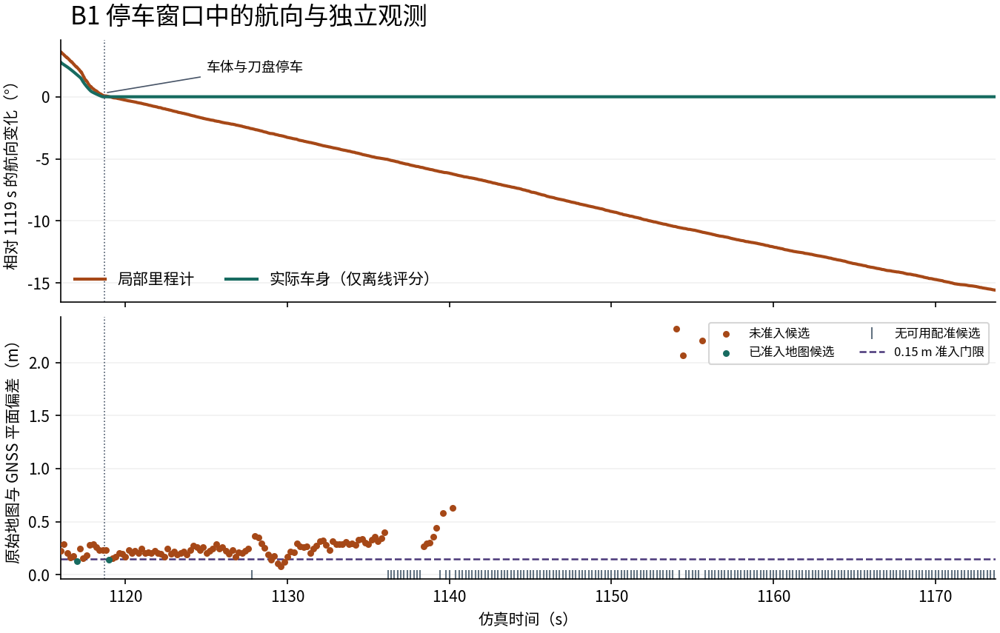

# B1 割草停车后的航向漂移与换挡反馈

## 如何读这一组复验

本轮全簇会话 `mowing_20261119_072044_764057` 使用已批准的 47 段安全执行路径，历史 34 段参照路线和原作业面积分母继续保存。本轮通过了第 19 号执行段 `B1:safe_turn:5:3`，继续按顺序到达 25/47 个执行段。它随后在 `B1:safe_turn:6:3` 停车，1173.702 仿真秒交由人工。全簇记录保留 PARTIAL。终检确认没有意外碰撞，车体始终位于允许地带，收尾时底盘与刀盘均已实测停止。

更早一次运行停在第 19 号段。当时停车、固定解 GNSS 和激光测量已满足核验窗口，割草任务心跳却缺少 `task_version`，C++ 监督器无法核对申请恢复的路径版本。当前割草任务向 ROS 及实时界面发送同一版本号；错版本和缺版本仍会被拒绝。修复后的五段入口带故障流程完成 5/5，本轮全簇也越过了之前停下的位置。[停车核验重放](../../../validation/R10/mowing_relocalization_window_20261119.json) · [任务心跳源码](../../../optimization_v2/ws/src/task_platform/scripts/mission_mowing_r10.py)

这次出现了两个应分别检验的问题。

* **车停了，估计航向仍在旋转。** 1122–1162 仿真秒内，离线评分的车体偏航角变化为 0，局部里程计航向却变化了 −0.2054 rad，约 −11.8°。最后一份通过准入的绝对地图航向来自 1119.0 秒。之后的 273 帧区域地图候选中，90 帧受到独立 GNSS 一致性门限限制，另有 179 帧地图几何匹配失败，4 帧校正幅度超界。停车窗口内监督器从未要求执行计划跳变复核，行为树等待新证据后以 `HUMAN_REQUIRED` 结束。
* **一次换挡间隔缺少刀盘采样。** `RECOVERY_GEAR_ARMED` 在 975.216 秒，下一条停车确认在 975.220 秒，两者间距只有 4 ms。独立物理记录是 20 Hz，前后最近采样分别在 975.202 和 975.252 秒，测得转速约为 2.33×10⁻¹⁹ 和 2.86×10⁻¹⁹ rad/s。原验收要求区间内至少有一条刀盘实测，这次没有满足。原始验收保留该失败项。[原始事件与测量](../../../validation/R10/candidates/original_B1_warm_hold.json)



## 为什么仍需绝对定位证据

车轮编码器能独立检验“静止时是否在转”，却不能提供地图中的绝对航向。为了区分里程计初值漂移和区域地图自身的匹配误差，离线读取六帧实际存档点云，保留同一冻结点云地图与原匹配算法。每帧使用当时的固定解 GNSS 扣除天线杆臂，再分三个接近的方向作初值，独立测量配准结果与 GNSS 的偏差。1121、1126、1131、1141、1151 秒的最佳结果仍相差约 0.19–0.25 m，超过原 0.15 m 门限。1166 秒这一帧重配准结果约 0.077 m，留出点的表面距离 P95 约 0.231 m。一次离线重算仍需接受在线时间、地图质量、NIS 和连续确认的约束。原执行过程中已经失去的定位与作业时间仍计入残余。[逐帧三初值和输入哈希](../../../validation/R10/candidates/original_B1_warm_hold.json)

对同一停车地点另做了细跟踪敏感性试验，保留最后一个已接纳地图姿态、原局部位移及原跟踪门限，仅改变后续输入给配准的局部航向。按五秒存档分辨率，原始种子在 11 帧中通过 0 帧；按 −0.005 rad/s 抵消静止偏差，1166 秒的一帧满足原跟踪门限，GNSS 残差为 0.0704 m，按原传感器协方差计算的 NIS 为 1.46，平移校正 0.090 m，航向校正 0.0083 rad。较小和较大的假设偏差分别得到不同结果。这里没有重演完整 EKF、5 秒间隔内的其他点云或监督器连续确认，单帧合格不能计为全簇通过。[细跟踪试验的逐帧数据](../../../validation/R10/candidates/original_B1_warm_hold.json)

## 候选实现如何工作

1. 输入适配器读取当前割草车会话生成的传感器接口。复用点喷车已使用的 `StationaryYawBias`。启动标定之后，只有 STOP 指令、底盘反馈、导航空闲状态、时间新鲜的轮速与偏航角速度均支持停车，而且没有独立打滑争议时，估计器才更新。连续静止达到 0.6 s 后，以 4 s 时间常数滤波“陀螺观测减编码器角速度”的残差。车辆转弯或数据过期时冻结已有偏差。真实运动仍会出现在传给局部融合器的 IMU 信号中。[偏差估计](../../../optimization_v2/ws/src/task_platform/scripts/stationary_gyro_r10.py) · [ROS 输入适配器](../../../optimization_v2/ws/src/task_platform/scripts/spray_inputs_r10.py)
2. 候选换挡逻辑在避障恢复停车后建立新时间屏障，要求同一会话、同一机具版号、健康、关刀、流量为零、绝对转速低于 0.1 rad/s 的连续新回传，以及新底盘停车反馈。累计确认跨度达到 0.10 s 后才能完成恢复停车。超时仍走原有报错通道。[工具停车逻辑](../../../optimization_v2/ws/src/task_platform/scripts/recovery_stop_candidate_r10.py)
3. `late-warm` 从原安全路径的第 21 号段入口物理出生，保留原来的粗定位提示和首次地图准入。从 12 仿真秒起，在仿真传感器端用 3 s 线性增加 −0.005 rad/s 偏差，同时保留原噪声、随机游走、数据延迟。控制器看不到注入时间表或仿真器真值。Nav2 激活后仍在出生点等待至至少 45 仿真秒，且实际等待至少 15 s，再依次执行第 21–27 号共七个原段，其中包括目标转弯与两个作业条带。候选有独立结果目录、执行源码哈希和运行时生成的传感器接口哈希。[候选启动器与物理终检](../../../optimization_v2/ws/src/task_platform/scripts/mowing_yaw_candidate_r10.py)

## 可先进行的手工复验

在项目根目录的 Bash 终端中执行。使用项目自己的场景解释器运行场景和几何检查。ROS 隔离测试使用已加载 Jazzy 的系统 Python。

```bash
cd /home/ceihao/robot_project
source optimization_v2/env.sh
scripts=optimization_v2/ws/src/task_platform/scripts
scene_python=optimization_v2/venvs/scene/bin/python
archive=optimization_v2/three_tasks/results/R12/mowing_20261119_072044_764057

# 生成并检查候选的世界和接口，结束后回收临时目录
"$scene_python" "$scripts/mowing_yaw_candidate_r10.py" late-warm --prepare

# 独立 ROS 域 174 中注入正常停车、真实转弯和过期反馈
/usr/bin/python3 "$scripts/probe_mowing_yaw_r10.py"

# 原始大运行目录在本机可用时，可复算原传感器记录
python3 "$scripts/replay_mowing_yaw_r10.py" "$archive"
"$scene_python" "$scripts/inspect_mowing_hold_r10.py" "$archive"
"$scene_python" "$scripts/plot_mowing_hold_r10.py" "$archive" /tmp/B1-heading.png
```

原始 IMU 实际交付 235,047 条，通过所有停车与编码器条件后更新 28,177 次。四个独立十秒窗口的原始平均偏差为 −0.00478 至 −0.00532 rad/s，校正后为 −0.00012 至 +0.00030 rad/s。50,736 个明显行驶并转向的样本全部保留了编码器转向符号。离线重放按传感器采样时刻对齐，实际 ROS 到达抖动由组件及 Gazebo 集成测试另行检验。[全流重放](../../../validation/R10/candidates/original_B1_gyro_replay.json)

隔离域中的实测 ROS 节点能够区分四种情况。已注入的 −0.005 rad/s 偏差在停车窗口下降至绝对值小于 0.001 rad/s；0.35 m/s 行驶并以 0.11 rad/s 转弯时保留真实转动；过期停车信息下的新漂移保持可见；进程正常退出。[ROS 实测输出与绑定](../../../validation/R10/candidates/isolated_ros_gyro.json)

## 启动与观察物理复验

Gazebo 测试串行使用项目的会话锁。先运行下列单个命令。结束时从打印的结果目录读取 `candidate_analysis.json`、`analysis_mowing_r10.json`、`mission_result.json` 和 `mission_events.jsonl`。

```bash
"$scene_python" "$scripts/mowing_yaw_candidate_r10.py" late-warm --rtf .4
```

在另一终端观察当前工作，不发送控制指令。

```bash
cd /home/ceihao/robot_project
runs=optimization_v2/three_tasks/results/R10/candidates
run_dir=$(ls -dt "$runs"/mowing_2* | head -1)
tail -F "$run_dir/mission_events.jsonl"
```

`WARM_TEST_STOP_BEGIN` 与 `WARM_TEST_STOP_END` 标记候选的物理停车窗口。`RECOVERY_STOP_FEEDBACK_CONFIRMED` 必须来自实际执行过的恢复停车。`ORIGINAL_SEGMENT_PASSAGE` 指出是否真正经过原目标。`TASK_STOP` 中会保留错误和残余，不能当作目标到达。按 Ctrl+C 只退出该终端的日志查看。任务结束后可在启动终端复算相同的独立终检。

```bash
run_dir=$(ls -dt optimization_v2/three_tasks/results/R10/candidates/mowing_2* | head -1)
"$scene_python" "$scripts/mowing_yaw_candidate_r10.py" late-warm --verify "$run_dir"
python3 -m json.tool "$run_dir/candidate_analysis.json"
```

`entry` 参数运行冻结入口开始的五段常规任务，保留正常仿真噪声。`full` 参数运行完整 B1 路径，保持 1800 仿真秒和原门限。晚段和入口各自通过以后，仍需完整 B1 实测，才有依据变更默认版本及正式状态。大运行目录保留在实际执行机器，仓库提供经过绑定的精简证据与重现命令。

## 真实冷启动结果

晚段出生会话 `mowing_20261119_084537_532941` 在 75.002 仿真秒按原等待上限停车，选中的七个段到达 0 个。机器收到了 342 帧区域地图证据（包含退出过程）；226 帧处于“初始化稳定性待确认”，116 帧固定解与地图的一致性未满足。第 8.4 秒的粗配准已经通过单帧 GNSS 检查，后续进入细跟踪；原 R09 割草车要求至少 18 个观测、3.5 s 跨度、最大间隔 0.6 s，再连续符合条件 3.0 s。此次最长合格仅 1.0 s。独立底盘与刀盘均实测停车，未启动工具或执行换挡。输入适配器通过 14,114 次停车更新调整了偏差，但本次整车未通过冷启动，保留 PARTIAL。[冷启动明细](../../../validation/R10/candidates/late_warm_cold_start/cold_start_summary.json) · [候选终检](../../../validation/R10/candidates/late_warm_cold_start/candidate_analysis.json)

## 从已验证的入口驶入晚段

第二个候选在原 B1 入口 `[110.2534, 50.3849, 0.2618]` 物理出生。该世界坐标和初始方向在 44 个既有实测会话完全相同，首次传感器定位准入时间介于 18.42 和 67.44 仿真秒。本次从零建立定位状态，重新执行导航生命周期。60 s 起，传感器用 3 s 增加相同的热漂移；达到定位准入后继续停车，等到至少 90 s，且持续至少 18 s 才驶出。[44 个首次定位回执](../../../validation/R10/candidates/verified_entry_selection.json)

从这里到原第 21 段入口的接驳长 11.751 m。使用与安全执行版相同的 Reeds–Shepp 状态空间、RRTConnect 和已知 10° 坡面避让包络，原半径 3.0983 m，路径共 304 个密采样，先前进、再倒车。车体加大包络在每个采样上都必须处于原允许区域内，换挡边界须停车。车上用真实 `IsPathValid` 再次核验当前栅格再发出 FollowPath。接驳的目标面积始终为 0，必须真实行驶到达后才轮到原第 21–27 段；接驳路径、工时、到达记录与覆盖账本独立呈现。[冻结接驳版](../../../optimization_v2/three_tasks/candidates/mowing_verified_entry_transfer.json) · [执行及评估源码](../../../optimization_v2/ws/src/task_platform/scripts/mowing_verified_transfer_r10.py)

隔离域 178 的接口预检实际启动 Jazzy 地图服务器与 Smac 规划器。两条换挡路径在冻结的静态先验上均通过。向观测层中途注入一片致命栅格后，两次实际服务调用均拒绝对应路径。移除该测试块后，两条路径再次通过。该短测不移动底盘。[Nav2 服务回执](../../../validation/R10/candidates/verified_entry_nav2_probe.json)

```bash
cd /home/ceihao/robot_project
source optimization_v2/env.sh
scripts=optimization_v2/ws/src/task_platform/scripts
scene_python=optimization_v2/venvs/scene/bin/python
"$scene_python" "$scripts/mowing_verified_transfer_r10.py" --prepare
"$scene_python" "$scripts/probe_mowing_transfer_nav_r10.py"

# 单独占用 Gazebo，重新冷启动并真正执行接驳及所选晚段
"$scene_python" "$scripts/mowing_verified_transfer_r10.py" --rtf .4

# 将以下目录换为本次命令打印的实际会话目录
run_dir=$(ls -dt optimization_v2/three_tasks/results/R10/candidates/mowing_2* | head -1)
"$scene_python" "$scripts/mowing_verified_transfer_r10.py" --verify "$run_dir"
```

在 `candidate_analysis.json` 中，`transfer` 给出接驳挡位、移动时间与独立机具样本，`original_selected` 给出七段中的实际通过项及未做完的工作。实时事件 `QUALIFICATION_TRANSFER_COSTMAP_CHECK`、`QUALIFICATION_TRANSFER_PASSAGE`、`ORIGINAL_SEGMENT_PASSAGE` 分别表示接驳核验、接驳到达和原任务到达。

原入口接驳的第一次实测于 36.24 s 首次获得位置，38.644 s 完成 Nav2 激活。车辆与刀盘一直停到 90.0 s，接驳第一挡通过实时地图验查，FollowPath 在 90.036 s 被接受。同一仿真时刻出现 `NO_OBSERVED_PROGRESS`，整个会话的 DRIVE 帧为 0。原任务的距离进展时钟从首次取得位置开始计算，特意加入的热漂移停车把 45 s 余额提前耗尽。这份失败记录保留。[原接驳运行和时间证据](../../../validation/R10/candidates/verified_entry_early_watchdog/watchdog_evidence.json)

随后的 `verified-entry-first-motion` 候选保持同一传感器、路径和停车门限，在**第一条接驳动作获准时**采集进度起点一次。此前必须完成原地图准入、换挡和实测路径检查。已有的 45 s 无进度保护及 0.1 m 进展尺度原样使用，重试和后续挡位没有重新起表的权限。可检查 `FIRST_TRANSFER_MOTION_CLOCK_ARMED` 事件。[时钟回归](../../../validation/R10/candidates/first_motion_clock_probe.json) · [候选绑定源码](../../../optimization_v2/ws/src/task_platform/scripts/mowing_transfer_clock_r10.py)

```bash
"$scene_python" "$scripts/mowing_transfer_clock_r10.py" --probe
"$scene_python" "$scripts/mowing_transfer_clock_r10.py" --rtf .4
```

## 第三次物理复验结果

`mowing_20261119_090706_626159` 完成了 51.688 s 的实测停车热漂移窗口。独立底盘速度峰值 0 m/s，末五秒陀螺仪与编码器偏航角速度均值相差 −0.0000341 rad/s。90.032 s 第一条接驳 FollowPath 获准，进度时钟只起表一次，随后底盘实测行驶。

110.25 s 车辆运动中最先进入第一挡终点容差，估计平面误差 0.09998 m、航向误差 0.04471 rad。116.4 s 停车后，平面误差为 0.1290 m，超出 0.10 m；两轮有界端点恢复后，163.44 s 的平面误差降至 0.0329 m，但航向误差仍为 0.1290 rad，超出 0.12 rad。独立物理评分同期航向误差为 0.1319 rad。163.584 s 向人工交接。从第一条接驳动作到安全停止共 73.552 仿真秒，控制门累计观测进展为 5.303 m。两挡接驳均未取得停车到达确认，原任务仍为 0/7、已确认 0 m²、留存 56.254 m² 选定目标差额。

该次会话有 9 次新的停车反馈握手，5 个实际恢复挡位区间分别具备 31、250、3、489、78 个独立 20 Hz 物理刀盘样本，流量均为零；最短区间为 134 ms。资格回执中的 `transfer.confirmed_gears` 表示瞬时经过的接驳点，停车完成情况应以独立复核的 `stopped_transfer_gears_completed` 为准。此轮可以确认停车热漂移与新的反馈握手机制已在整车上运行，晚段连续作业和接驳停车到达仍需再验证。[独立物理复核与逐次测量](../../../validation/R10/candidates/verified_entry_first_motion/physical_review.json) · [原终检结果](../../../validation/R10/candidates/verified_entry_first_motion/candidate_analysis.json)

### 110–114 秒之间可以提前确认停车到达吗？

把每个定位输出与同一会话此前最近的一条 BT 决策、控制门、风险、段号及带版本的实测刀盘反馈对齐。原接驳第一挡目标的 110.73–114.21 s 间，有 117 帧同时具备有效定位、安全地界、BT 允许执行、底盘静止、刀盘实测停止。估计平面误差为 9.42–10.00 cm，航向误差为 0.0367–0.0376 rad。111.33 s，17 个不同里程计时戳跨过 0.626 s，原 `stable_arrival` 的位姿时间窗口首次成立。

控制层给出了另一部分现场事实。全部 117 帧中，导航动作仍活跃，车处于前进挡，RPP 请求 −0.0573 至 −0.0582 m/s 的倒车速度。方向保护连续发出 `NAV_COMMAND_RANGE` 并切断速度，因此底盘能够持续静止。在这种情况下，仅采纳 BT 的“可以执行”、双停以及估计位姿窗口，会把一个方向冲突误签为换挡处到达。原任务后来真实地停止并交给人工处理。

同一时段有 18 个真实交付的 RTK 固定解。按标定杆臂 `[0.6, 0, 1.55]` m、有效的 IMU 滚转/俯仰与当时地图航向，将天线观测反算到车体原点。目标误差中位数为 **11.01 cm**。每次观测报告的水平标准差最大轴约 3 cm。使用原监督器的二维 NIS 系数 9.21，取水平误差椭圆的外接圆，得到约 9.10 cm 误差半径。把目标距离和这个半径相加的范围是 16.16–24.03 cm，18 个观测中没有一个能用该模型把车体位置完整限定在原 10 cm 圆内。这里逐次检查，未将相邻 GNSS 简单平均来缩小误差；数据来自现有车上传感器，杆臂标定、地图航向相关性及采样到回调的延迟仍需现场评估。

最后用只供离线评分的仿真物理输出单独检验。车速为零、刀盘关闭，但车体平面误差一直为 **13.12 cm**，117 帧中实际满足原到达精度的有 **0 帧**。因此保留原停车失败与未完成接驳记录。后续若要做端点重规划，应先让新路径验证完整车身和进退挡可行性，达到同一目标后等待导航动作真正终止，再独立复核定位和停车。这里的误差包络是只读诊断，不能发布速度或签发作业完成。[源数据窗口和完整原文件哈希](../../../validation/R10/candidates/verified_entry_first_motion/early_endpoint_window.json) · [压缩采样片段](../../../validation/R10/candidates/verified_entry_first_motion/early_endpoint_window_inputs.json.gz) · [离线复核代码](../../../optimization_v2/ws/src/task_platform/scripts/audit_mowing_checkpoint_r10.py)

用 Python 3.9 或更新版本从仓库根目录执行。此处只读取已提交的 128 KiB 采样片段，Linux 和 Windows 都能复核，无需安装 ROS 或启动 Gazebo。

```bash
python3 optimization_v2/ws/src/task_platform/scripts/audit_mowing_checkpoint_r10.py validation/R10/candidates/verified_entry_first_motion/early_endpoint_window_inputs.json.gz --output /tmp/B1-stop.json
sha256sum /tmp/B1-stop.json validation/R10/candidates/verified_entry_first_motion/early_endpoint_window.json
```

Windows PowerShell 可以执行以下两行。输出文件写在系统临时目录。本次 Linux 实测两份 SHA256 完全一致。若另一系统的数学库产生末位浮点差异，请核对 117 帧、18 个固定解、物理通过 0 帧及厘米级误差。

```powershell
py -3 optimization_v2/ws/src/task_platform/scripts/audit_mowing_checkpoint_r10.py validation/R10/candidates/verified_entry_first_motion/early_endpoint_window_inputs.json.gz --output "$env:TEMP/B1-stop.json"
Get-FileHash "$env:TEMP/B1-stop.json", "validation/R10/candidates/verified_entry_first_motion/early_endpoint_window.json"
```
