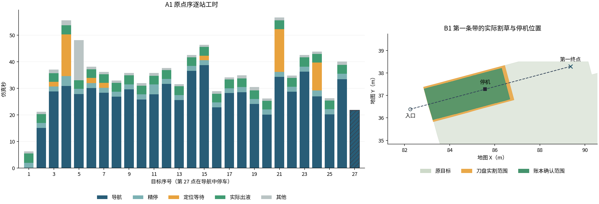

# R10 点喷逐站工时与割草整簇入口复验

A1 工时与点序优化专项 **PASS（离线）**。对既有 26 个已确认点逐站核算；56 个原目标的新点序通过距离、转角、作业义务与场景装配检查。新点序整车行驶记为 `NOT_RUN`。B1 本轮从原入口选入全部 46 段，第一条带中途安全停车转人工，实测 **0/46 段，PARTIAL**。后续修复通过离线回放。原 R10 的 9 个案例通过 7 个，R10、R11、R12 保留原阶段结论。[正式案例](R10/RESULTS.md) · [原阶段复核](../../validation/r10_bounded_20261119/stage_check.json)



## A1 的时间花在哪里

从前一站确认到本站确认，以同一个仿真时钟区间分账。第一站从首次发出导航目标算起。工具用独立物理流量判断实际出液，精停包含局部纠偏，定位等待只计任务明确进入定位恢复的时间。导航包含控制器自身停车。其他时间单列，包含工具准备、确认、部分感知等待和动作交接。每一秒只计一次。[每个原目标的 CSV](../../validation/r10_bounded_20261119/a1/point_phase_profile.csv) · [定义、逐点数据与输入摘要](../../validation/r10_bounded_20261119/a1/point_phase_profile.json)

| 已确认的 26 个点 | 仿真秒 | 占 936.204 秒比例 |
|---|---:|---:|
| 站间导航 | 707.364 | 75.6% |
| 精停 | 53.398 | 5.7% |
| 定位等待与恢复 | 49.360 | 5.3% |
| 实际出液 | 86.200 | 9.2% |
| 其他 | 39.882 | 4.3% |

26 个点中，25 个以导航最耗时。车身实测在导航期间平移 579.500 秒、转动 75.152 秒、静止 52.712 秒。控制命令近零持续 203.874 秒，车身的运动响应有延迟，两个观测量分别保留。第 27 点只发生了 21.692 秒导航及少量交接；其余 29 点未开始，工时留空。加上启动、末次未完成操作和清理后，原记录合计 978.792 仿真秒。该记录中 26 个已喷点的剂量与位置都经过物理检查。[六次历史运行比较](../../validation/r10_bounded_20261119/a1/phase_history.json) · [逐点独立物理核验](../../validation/r10_continuation_20261119/a1/full-56.json)

## A1 在相同距离上少转弯

同一次原序实测中，连续 3 米直行段的导航中位数为 25.594 秒（9 段）；到站方向改变 90° 的中位数为 29.586 秒（13 段）。优化器用 SciPy/HiGHS 求解带转角代价的整数规划，约束首末点、所有 56 个原点各一次、最大单边长度和总距离，逐边校验车身包络与先验边界，再排除互不连通的小环。优化结果使用原有 Nav2、精停和工具反馈入口。已核对 4 点与 56 点两种规模生成的作业、定位和工具版本。[规划器源码](../../optimization_v2/three_tasks/spray_equal_length.py) · [场景与绑定检查](../../validation/r10_bounded_20261119/a1/travel_scene_checks.json)

| 原计划和新计划 | 原点序 | 新点序 |
|---|---:|---:|
| 首末作业点之间的总长 | 167.485 m | 167.485 m |
| 累计转角 | 50.265 rad | 34.558 rad |
| 距离 ÷ 线速度上限 + 转角 ÷ 角速度上限 | 701.900 s | 657.020 s |

在上述边集合和距离上限内，求解器给出的最小转角与候选一致。**转角减少 31.25%，运动代价估计减少 44.88 秒。** 新序 55 段中，12 段在历史完成记录中以同向出现，1 段只以反向出现，42 段在这批行驶样本中两向均未见。这个专项可按本轮缩短验证的要求通过，实际节时、本版整体成功率和 30 分钟内全簇完成情况仍待实测。[点序与求解结果](../../optimization_v2/three_tasks/candidates/A1_equal_length_turns.json) · [原序分段对照与适用范围](../../validation/r10_bounded_20261119/a1/travel_order_replay.json)

## B1 从入口出发后发生了什么

本轮唯一一次 Gazebo 整车运行使用冻结的 46 段路径，从地图坐标 (82.253, 36.385) m 出发，地图航向约 15°。在第一条带行驶和开刀时，共记录 6 次导航中断、1 次开刀启动中断。对应的行为树决策均为 `PERCEPTION_ADMISSION_WAIT`。各次定位有效、阻塞标志为假，风险栅格年龄达到约 0.450–0.476 秒，触及原 0.45 秒新鲜度上限。第七次中断后，程序触发原有连续重试上限，在 53.894 仿真秒安全转人工。整场耗费 125.44 秒现实时间，运行进程正常退出。[逐次取消、最终停机姿态与录像校验](../../validation/r10_bounded_20261119/b1/entrance_observations.json) · [实际相机录像](../../media/r10_bounded_20261119/b1_entrance.mp4)

| 本次整簇实测 | 结果 |
|---|---:|
| 选入 / 完成 | 46 / 0 段 |
| 安全停车距第一段目标 | 3.915 m |
| 停车时车身朝向与第一目标的夹角 | 0.093° |
| 原目标面积 | 188.392 m² |
| 独立刀盘轨迹与原目标的交集 | 5.952 m² |
| SQLite 账本确认的有效面积 | 5.084 m² |
| 按账本剩余的原目标面积 | 183.308 m² |

地头换向位于第 23–26 个执行段，本次均未抵达，整簇条件下的换向停车误差留空。此前单独从换向入口出发的四次停车均通过，最大位置误差 9.38 cm，最大航向误差 1.43°。停车评分器重新恢复了那四次的原始误差，也检出了主动注入的航向错误、错误行驶方向和刀盘观测缺失。本场唯一的刀盘有效面积来自第一条带。[逐段评分和剩余量](../../validation/r10_bounded_20261119/b1/full_46_physical_report.json) · [四次历史换向停车评分](../../validation/r10_continuation_20261119/b1/physical_connector_report.json) · [评分回归](../../validation/r10_bounded_20261119/b1/evidence_regression.json)

## B1 对两处问题的修复

1. **缩短地形计算时间。** 在每帧开始时读取标定常量，以栅格索引访问邻域高度，并单独保留“已观测”标志。用五组既有激光点云比较完整原生回调，原实现和候选各运行 30 次，四张风险／确认栅格与几何、健康输出（计时字段除外）一致。回调中位数由 51.08 ms 降至 31.69 ms。现场链路还包含采集、传输和调度，端到端的新鲜度要等下一次整车运行再测。[地形实现](../../optimization_v2/ws/src/task_platform/scripts/b1_terrain_timing.py) · [逐帧回放与计时](../../validation/r10_bounded_20261119/b1/terrain_callback_replay.json)
2. **让车辆的实际进展被重试计数器看见。** 第一条带的路径顶点间隔约 9.94 cm。旧方法按每个短控制周期在可达范围内找下一个离散顶点，车辆前进了数米，记录值仍为 0。候选把位姿投影到当前路段的连续弧长，只有定位与放行信号新鲜、挡位一致、实际里程计沿该方向移动时，才将新走过的距离用于重试判断。观测间断只允许重新建立位置参照，已经走过的弧段不能重复计数。对本次原数据回放，修复版保守认可 2.349 m 有效进展，两次满足原有 0.8 m 进展条件，第七次中断时连续计数为 1；旧版为 7。工具启动中断独立占用一次尝试。车辆仍必须执行每一次取消与停车，累计中断上限、整段时限、终点门限、面积结算均照常执行。[进展计算与新入口](../../optimization_v2/ws/src/task_platform/scripts/qualify_b1_progress.py) · [同一份观测的逐次结果](../../validation/r10_bounded_20261119/b1/progress_replay.json)

两项修复已经组装为同一个候选入口，未追加第二次整车运行。当前可复现原终止，修复后的后续里程、停车误差和实割面积保持待测。

## 在本机复查

以下命令从项目根目录运行。前三组复算和组装都不启动 Gazebo。在新机器先依照项目构建说明恢复 ROS、仿真资产和冻结导航版本。[环境搭建](../../BUILDING.md)

```bash
cd /home/ceihao/robot_project
run=optimization_v2/three_tasks/r10_workload.sh
evidence=validation/r10_bounded_20261119
scripts=optimization_v2/ws/src/task_platform/scripts

# 从压缩的公开观测重建六次逐点工时，与发布的 JSON/CSV 比对
bash "$run" profile --verify

# 重新求解点序、回放原来实际行驶的路段、离线组装四点任务
bash "$run" spray_travel check
bash "$run" spray_travel replay
bash "$run" spray_travel prepare --count 4

# 七次中断，用原方法和修复版对同一记录计数
bash "$run" progress_replay --trace "$evidence/b1/progress_trace.json.gz"

# 从公开观测复算刀盘面积、账本和旧四次换向的评分
source optimization_v2/env.sh
python_app=optimization_v2/venvs/scene/bin/python
"$python_app" "$scripts/verify_b1_full_replay.py"
"$python_app" "$scripts/test_b1_progress.py"

# 离线组装下一版 B1 的完整入口、底盘、工具与修复后的地形节点
bash "$run" mowing_progress prepare --rtf .85 --wall-seconds 2880
```

下次有额度时，下面这条命令启动一场整车仿真。应首先查看第一条带是否完成，随后查看第 23–26 段换向的停车位置与航向，最后核对刀盘和账本的面积。运行会生成独立目录；原版本的回执和录像继续可用。

```bash
bash optimization_v2/three_tasks/r10_workload.sh mowing_progress run --rtf .85 --wall-seconds 2880
```
