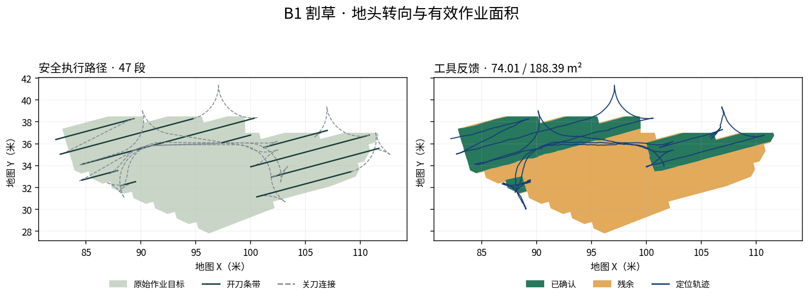

# 三任务作业复验与复现

本轮以 2026 年 11 月 15 日的机器人版本 `9aff8337` 为对照。原地图、A1 的 56 个点、B1 的原作业目标、批准的 47 段安全路径和每簇 1800 仿真秒上限构成本轮的比较条件。

## 运行结论

本轮在 1800 仿真秒的整簇任务上限内，A1 账本确认 22/56 个点，B1 逐段确认 25/47 段，工具实测确认 74.01 m²、残余 114.38 m²。11 月 15 日对照结果为 A1 28/56、B1 19/47。巡检和持续封堵沿用各自已封存的同版本记录。 B1 在定位证据不足后有界停车并请求人工。A1 本轮确认车体与工具停止，任务观察进程返回 2，其余进程退出且无强制终止，原运行检查仍为未通过。A1 记录的终止原因是 `RuntimeError('DOCKING_REALIGNMENT_EXHAUSTED')`。三任务 R01–R09 原始阶段回执的字节哈希与本轮开始时逐项一致。[整簇与专项运行清单](../../validation/closeout_20261119/runs.json) · [A1 剩余点](../../validation/closeout_20261119/A1_residual_review.json) · [原回执保护检查](../../validation/closeout_20261119/protected_receipts.json)

A1 本轮前 22 点耗时 902.06 仿真秒，同一前缀的离线估计为 571.98 秒。截止时所有 22 个已记账点都有独立剂量与位置反馈，最大实测作业误差 4.22 厘米。完整 56 点的校核继续沿用原分母。第 23 点最后一次停车中位误差为 3.73 厘米，而准入要求为 3.50 厘米。[逐点工时与路径估算对照](A1点喷工时校准.md) · [终止窗口的感知、控制和工具证据](../../validation/closeout_20261119/spray_full_diagnosis.json)

## 如何看三种结果

- 点喷只统计账本确认完成的原始点。工具取消后可以保留已确认剂量，补作只需完成残余。三点卡滞专项的分母为 3，整簇运行的分母为 56。
- 巡检的完整道路长 88.48 m。前车跟随、停车恢复、绕行与持续封堵转人工分别有独立场景和记录。
- 割草分别核查路径段、覆盖面积和停车。地头连接时关闭工具。工具反馈多边形的并集与原目标求交后才计入面积，不能用已行驶段数推算覆盖率。持续受阻时要求有界停车、车体和工具状态确认，以及保留残余。

当前 B1 有 10 段开刀、37 段关刀。把模型的 0.70 × 1.60 m 刀盘沿中心线扫过，按每个原始作业键的边界裁剪再求并集，得到 **112.79 m²**，约为原目标 188.39 m² 的 **59.87%**。这是车辆无偏差沿计划行驶时的几何估计。现场偏移、启动和停止、传感器置信度以本次实际反馈为准。原计划字段中的 96.12% 是旧计划相对整个 195.99 m² 簇的比例。[逐条带几何复算](../../validation/reproduction/b1_nominal_sweep.json)

原始目标中有 **29.61 m²** 与已批准的 10° 坡面禁行区相交。计入车体要求的 0.10 m 边界余量后，共 **31.66 m²** 落在允许整车占用的区域以外。平面模型中刀盘完整包含于车体内，所以任何遵守现有边界的路径，最多只能触及原目标的 **156.73 m²，约 83.19%**。这个上界只说明哪些地方在几何上有可能触及，实际还要满足整车可达、时间和反馈门限。它也解释了为什么延长等待无法把本区域补到 95%。[边界和坐标复算](../../validation/reproduction/b1_nominal_sweep.json)

## 本轮修复

**点喷停车时的航向漂移。** 仿真注入的 IMU 零偏会随时间变化。原驱动在启动静止期完成标定，此后只靠同一个零偏估计。新点喷驱动把同一采集时段的陀螺仪、轮速和实际控制状态对齐，只有满足持续停车、空闲导航、无滑移等证据时才更新航向角速度偏置。独立 ROS 测试包含实际旋转和停车证据失效的情况。定位跳变门限、工具精停门限和最大重试次数沿用原配置。任务结果和进程关停分别评分。[标定方法与实测](R10/STATIONARY_YAW_BIAS.md)

**割草停车后不能重新定位。** 旧作业进程发送的心跳缺少计划版本。定位监督器在验证“车已停、刀已停、观测新鲜、计划一致”时会拒绝缺少版本的候选。新作业进程每次发送实际计划版本。真实 ROS 服务测试覆盖缺失版本、错误版本、正确版本、规划预览、提交和恢复确认。原 879.272 秒中断时，同期独立 GNSS 校核为有效；关停过程稍后的最后一条快照记录了不同结果。[中断窗口原始统计](../../validation/R10/mowing_relocalization_window_20261119.json)

**复验时保留原运行证据。** 阶段汇总核对实际任务、分簇、故障、起始段、选择数量和时限。对于代码仍一致的运行，在临时目录重新执行原评估器，SQLite 账本和 WAL 使用私有副本，从而保留原现场的报告和索引。对于已经结束的旧版本，记录当前实现与当时绑定的差异，保留原版本的作业和录像结果。GUI 的“作业账本与残余”页在存在 `TASK_STOP` 时另外展示当时可用的定位、BT 和车体/工具停车观测，读数按仿真时间对齐。找不到同期记录的通道会明确显示缺失。

## 手工复现

在原开发机进入项目根目录。以下命令只读取环境和证据，最后一条打开实时观测台。其他 Linux 工作目录的地图还原、ROS 接口构建和环境绑定见[独立克隆实测说明](复现检查.md)。

```bash
cd /home/ceihao/robot_project
source optimization_v2/env.sh
python3 optimization_v2/three_tasks/doctor.py assets
optimization_v2/venvs/scene/bin/python optimization_v2/three_tasks/doctor.py plans
optimization_v2/venvs/scene/bin/python optimization_v2/three_tasks/doctor.py runtime
bash optimization_v2/three_tasks/gui.sh
```

打开浏览器 http://127.0.0.1:8088。另开终端运行一个案例，等待它完成退出后再启动下一个。第一组使用独立 ROS 队列验证定位组件；第二组使用 Gazebo、真实传感器链路、工具和录像。

```bash
cd /home/ceihao/robot_project
bash optimization_v2/three_tasks/advance.sh R10 test stationary_gyro
bash optimization_v2/three_tasks/advance.sh R10 test mowing_stopped_revalidation

bash optimization_v2/three_tasks/advance.sh R12 record spray
bash optimization_v2/three_tasks/advance.sh R10 import-recording spray_tool_jam
bash optimization_v2/three_tasks/advance.sh R10 test record_mowing_startup_perception_loss
```

分别复验完整任务时使用以下入口。录像会同时生成，墙钟用时取决于机器。需要人工中止时在任务终端按一次 Ctrl+C，等待实测车体与工具停稳并完成进程退出。

```bash
bash optimization_v2/three_tasks/advance.sh R10 test record_mowing_full_B1
bash optimization_v2/three_tasks/advance.sh R10 test record_spray_full_A1
```

检查已封存的阶段回执。输出中的 `changed` 列出已经与回执不同的本机文件。`PARTIAL` 返回退出码 2，已通过短例的进度和原始录像均可单独查看。

```bash
bash optimization_v2/three_tasks/advance.sh R10 check
bash optimization_v2/three_tasks/advance.sh R11 check
bash optimization_v2/three_tasks/advance.sh R12 check
```

[三任务实录片段和原片](../../media/closeout_20261119/README.md) · [碰撞告警观测方法](R10/COLLISION_OBSERVATION.md)

## 在 Windows 上按仿真时刻查验

下载随仓库提供的 HTML，用 Edge 或 Chrome 直接打开。页面自身包含观测数据，无需 ROS、Python 或本地服务器。选择运行后，滑动时间条，或跳到工具开始、导航取消、完成点位和请求人工等实际事件，再查看同一时刻的 BT 原因、地图定位、GNSS 创新量、车体与工具停稳状态。相邻观测的采集时间不同，过期通道显示“无同期样本”。现场监视仍通过 Linux 实时 GUI 进行。[离线事件回放](../../validation/closeout_20261119/replay.html) · [浏览器文件模式实测](../../validation/closeout_20261119/replay_browser.json) · [新手观察路线](第一次观察三任务.md)



B1 的 9 个原始开刀作业键中，本次有 5 个留下有效反馈，3 个尚无作业记录，另有 1 个在这版安全路径中没有足够长的合格片段。各键的多边形可能重叠，总残余采用并集。可在 GIS 软件查看压缩 GeoJSON 中的原目标、工具确认和残余三层，单位为本项目局部地图的米。[逐作业键检查单](../../validation/closeout_20261119/B1_residual_review.json) · [原精度图层](../../validation/closeout_20261119/B1_coverage.geojson.gz)

在 Linux 上可从一次已经退出的运行重新生成核对单。程序读取实际计划、任务终态和反馈分析，校核计划版本与 Point32 工具多边形的传输精度。点喷核对单保留每个原始目标及其剂量；割草核对单保留所有原作业键、批准的路径片段及未工作面积。发现定位、坡度或通路问题时，操作员可据此安排现场检查。

```bash
cd /home/ceihao/robot_project
python3 optimization_v2/three_tasks/residual_review.py \
  optimization_v2/three_tasks/results/R12/mowing_20261119_072044_764057 \
  --output /tmp/B1_residual_review.json
```

## 一个点无法到达时，能否先做其余点

在 A1 原点序中取连续四点，用实体障碍占用第二点。真实 Nav2 连续三次导航失败，实际发生两次重规划。第 80.944 仿真秒，原生行为树发出第 14 号决策 `TRY_OTHER_OBLIGATION_RETAIN_RESIDUAL`。作业器核查任务版本、定位、风险、车体和工具停稳，保留该点全部 3.0 剩余剂量。机器人随后到达原序列的 9_20，第 141.844 秒收到 3.078 的计量反馈。最终四点有三点完成，单独的受阻重选行为通过，A1 整簇仍按本轮 22/56 记录。该案例验证粗导航受阻后的处理。对精停阶段两次碰撞预警后的重选，已有真实失败数据与原生行为树的独立回放，仍待同一现场运行验证。[复现方法与代码](../optimization_v2/spray_defer_candidate_20261119.md) · [47 秒录像](../../media/closeout_20261119/spray_defer_highlight.mp4) · [独立验收项](../../validation/closeout_20261119/spray_defer/candidate_acceptance.json)

在离线事件回放里选择 `bounded_defer`，再从事件下拉框选 `CANDIDATE_DEFER_CONFIRMED`。能同时看到第 14 号决策、被跳过点的剩余剂量、下一个原始点和同期停机证据。下载完整仓库并解压，还可在选片页按实测事件和章节跳转。[离线证据回放](../../validation/closeout_20261119/replay.html) · [事件选片](../../media/closeout_20261119/index.html)

B1 第六地头另有一条独立备选。相同起终位姿、原开刀条带与坡度门限下，含作业衔接的换向由 6 次降至 4 次。全路线几何复核和四个单挡段的原生 Nav2 障碍拒绝测试均已通过，行车与定位受阻仍依据现场复验。[路线对照、图与复核命令](B1地头连接对照.md)

### 同一个故障点在自然场景能否恢复

在独立无障碍注入的四点试验，`point_10_20` 先后出现 6.10 厘米和 8.61 厘米精停偏差。BT 取消局部动作，车辆停车请求重新定位，校验原端点路径后提交新的定位版本。第三次停车观测偏差为 3.16 厘米，通过原 3.50 厘米准入，第 90.874 仿真秒确认 3.072 剂量。该次共完成 3/4 点，另一点 `point_9_20` 工具取消后确认 0.590，保留 2.410。观察进程返回 2，人工接管未触发。这段记录说明原故障点在一次独立现场通过了恢复，不能补记原 A1 整簇。[31.6 秒连续重定位节选](../../media/closeout_20261119/spray_natural_relocalization.mp4) · [402.2 秒原片](../../media/closeout_20261119/spray_natural_full.mp4) · [时标与原始剂量](../../validation/closeout_20261119/spray_natural_media.json)

### 割草地头接驳为何保留残余

独立晚段专项分别从冷启动、从已有定位证据的入口停车校准、从同一入口真正接收第一个运动动作后计时。第三次验证了实际起步与换挡停机的独立反馈，接驳车体累计移动约 5.30 米。它没有进入所选七个原作业段，未新增割草面积。看似已到达的窗口中，117 次在线融合位姿落在 10 厘米内，同时前进挡仍收到反向速度请求。18 次固定解 GNSS 按杆臂换算后距离端点中位值 11.01 厘米，独立物理参考为 13.12 厘米。最终停车的位置误差已降至 3.29 厘米，航向误差仍有 0.129 弧度，高于 0.12 弧度门限。保留双停和人工处理符合原条件。[接驳三次复验、原始窗口与命令](R10/MOWING_WARM_HOLD.md)

`point_9_20` 的 0.590 是同一 SQLite 作业键在两次取消后的最终累计合格量。独立物理总表在该键下实际增加 1.0353，按物理评估器对 20 Hz 相邻流量保守积分得到 0.9547，三者分别记录。原始总表含未同时满足姿态、工具与授权条件的流量，工具账本只按合格反馈入账。[两次动作、物理表与 SQLite 对账](../../validation/closeout_20261119/spray_natural/point_9_20_dose_audit.json)

## 最后一个所选点长期受阻时怎样请求人工

在独立两点任务中，第一点 11_20 确认作业，末点 10_20 被实体设备占据。修复前，原生 BT 在 69.400 仿真秒锁存人工请求，上层仍等待下一次执行许可，等待超时，独立订阅器收到 0 条通知。修复后，执行器在再次派发运动前响应同一会话、同一版本的人工锁存。真实发生两次导航失败和两次原生重规划，第 68.676 秒收到第 12 号人工决策，未再派发运动。第 68.688 秒收到工具 `STOPPED` 回执并复核底盘与工具停稳。独立 ROS 订阅器收到报警和关闭确认两条消息，内容与磁盘一致。所选两点完成一个，末点仍欠 3.0，原 A1 的另 54 点没有派工。这一场的**人工交接专项通过，任务终态仍是 HUMAN_REQUIRED**。正式覆盖验收门限保持原值。[27.4 秒实录](../../media/closeout_20261119/spray_last_blocked_handoff.mp4) · [原始消息验收](../../validation/closeout_20261119/spray_last_blocked/operator_attention_receipt.json) · [独立命令与原理](../optimization_v2/spray_operator_handoff_20261119.md)

在实时 GUI 的“作业账本与残余”页查看独立候选结论；在原始证据下拉框选“现场人工接管通知”，可核对点位、原因码、第 12 号决策以及停车的独立判定。[浏览器对照实测](../../validation/closeout_20261119/gui_operator_browser.json)

本轮共结束 11 次 Gazebo 任务，从每次仿真时钟零点累计至各自任务终态，合计 3,345.022 秒（55 分 45 秒）。其中两次为正式选择整簇复验、两次为已有短案例的新版本复验、七次为独立诊断或行为场景。此前封存的巡检与影片不计入这段时长。[总回执与阶段状态](../../validation/closeout_20261119/delivery_checks.json)
